# GCN-ALNS / RLC-HFTSP 实验报告

> **验证器版本说明（2026-10-27）**：已修复恢复任务未等待恢复节点空闲、最终可行判定遗漏 CPU/内存容量检查的问题，并纳入无故障调度的有效性标记。下文主实验、消融、预算及模型 A/B 数值仍为修复前验证器生成的历史结果，尚未按修复后版本重跑；不能将本次测试通过理解为对这些历史可行率和恢复指标的重新认证。修复与小范围影响检查见 [`docs/VERIFIER_CORRECTNESS_FIX.md`](../docs/VERIFIER_CORRECTNESS_FIX.md)。

> **⚠️ 成本模型修正说明（2026-09-11）**
> 本轮修正了成本模型中的若干错误并**重跑实验**：①`C_total` 删除重复计入的 `C_backup`（`C_total = C_compute + C_comm + C_reserve + C_recovery`）；②`C_comm` 改为对**所有副本对**求和（与调度模型一致，主动备份的每个副本都计通信费）；③恢复风险改用标准 `math.exp`；④`InsertCost` 的 cost 分量计入入向通信成本（原为恒 0 占位）；⑤`_comm_in` 清理。
> **数据状态（2026-09-22，全部完成）**：Phase-1（`main_small/medium`、`main_hard_small/medium`、`ablation_*`、`budget_*`、`model_ab`）与 **Phase-2（`main_large` 450 / `main_hard_large` 180）均已用新成本模型跑完**，`aggregate` + `plots` 已在全量数据上重跑，`results/csv/*` 与 `results/figures/*` 现已覆盖三规模 + 难档全部结果。正文与附录的 `[待Phase-2]` 标记已全部清除。
> - 消融已提到 `repeats=10`（14 变体 × 750 run），并做配对 t 检验 + Holm 校正（见 §7）。
> - **外部基线 RECR-D / HFWPF 已于 2026-09-22 重跑**（修复见下条），旧记录备份于 `results/raw_json/main_*_prerecrdfix.{json,jsonl}`。
> - 旧成本模型结果备份于 `results/_backup_precostfix_20260909_190103/`。
>
> **⚠️ 外部基线修正说明（2026-09-22）**
> 复核 RECR-D 时发现两处适配缺陷（详见 `src/gcnalns/reproductions/README.md`）：
> ① **Alg.1 的平衡因子 DB 原为静态**——`rho` 只在结构 makespan 处算一次，于是每个任务都独立获得完整的 `LFT_i − EFT_i` 松弛。在 150 任务的 medium 实例上这是**人均 ~38 时间单位，而全局松弛仅 ~11**，导致 150/150 任务都"满足"自己的子截止期，而 `C_max` 超 `D` 两倍、Alg.2 的截止期门形同虚设。现改为随放置推进重算（`_shared.DynamicSubDeadlines`），即论文所称的 *dynamic* balance。
> ② **规划序与评估序不一致**——`compute_schedule` 按规范拓扑序回放每个节点的队列且忽略 `solution.order`，而节点时间线是 append-only（无空隙插入）。Alg.2 原按 EDF 序规划，于是它规划出的 `C_max=103` 被重排成 `262`。因 Alg.2 把负载集中在廉价资源上（150 任务中 48 个落在同一节点），这一错配的代价远大于共用 `_greedy_eft_place` 的分散型基线。现改为按评估器的回放序规划，规划值与评估值完全一致。
>
> 修复后 RECR-D 的 makespan 不再被虚高，**安全余量（距可行的差距）大幅收窄：small −60.2→−34.2、medium −174.3→−69.0、large −394.1→−113.5**；HFWPF 因忠实 Alg.1 也略有提升（medium 0→3.3%、large 13.3→20.0%）。但**可行率仍接近 0**，原因是结构性的而非复现缺陷，见附录 C。

> 本报告基于本机（`d:\zyx\gcn-alns`，32 核 CPU + 1×A40 49GB，conda 环境 `gcnALNS`，torch 2.5.1+cu121）的完整实验。
> **正文 §1–§9 描述"主对比"图**（`results/figures/`，来自 `main_small`+`main_medium`+`main_large` 汇总，见 `results/csv/summary_by_*`）。
> **附录 A/B** 记录两轮迭代改造(新数据集/A2 修复、收敛/难档/B 系归因/时间效率)的完整分析与数值。附录 A.2/A.3/B.1–B.6 与正文 §1–§9 现已全部基于同一份新成本模型的全量数据(三规模 + 难档),两处不再冲突。
> 注:主对比覆盖 **small/medium/large 三规模**;large 用 `repeats=5, max-iter=800`(large 既定惯例,单解 ~4.5h),small/medium 用 `repeats=10, max-iter=1000`。

## 1. 实验配置概览

| 项目 | 配置 |
|---|---|
| 实例规模 | small=50 / medium=150 / large=500 任务与节点，各 45 / 30 / 15 个（共 **90** 实例） |
| 工作流类型 | Montage, CyberShake, Epigenomics, LIGO, SIPHT |
| SLA 场景 | tight(α1.15/β0.05)、medium(α1.30/β0.10)、loose(α1.50/β0.20)（另有难档 tight2/tight3,见附录 B） |
| 对比算法 | HEFT, PEFT, No-FT, Reactive-Only, Full-Proactive, Critical-Path Backup, Criticality-Based Hybrid, Reliability-Aware, ALNS, **GCN-ALNS** |
| 随机算法 | ALNS / GCN-ALNS 多 seed 重复（repeats=10、ALNS 迭代=1000） |
| GCN 模型 | 满迭代 teacher + mode 标签重训，**test pairwise AUC=0.889**；默认模型已升级为 A2 修复版(mode AUC 0.975,见附录 B.4) |
| 判定口径 | 所有算法统一经 `core.recovery.verify` 判定 SLA 可行性 |

主对比 run 数（新成本模型，14 算法）：`main_small`=2250、`main_medium`=1500、`main_large`=450（合计 **4200**）；消融 14 变体×750（`repeats=10`）；另有 `budget_*`(5×900)、`main_hard_{small,medium,large}`=840/560/180、`model_ab`=1350（见附录 B，不并入主对比汇总）。

**总体结论（三规模全量，n=4200）**：仅 **ALNS / GCN-ALNS** 达成显著 SLA 可行率，且 **GCN-ALNS 在可行率更高的同时成本更低**——三规模全局 **GCN-ALNS 可行率 0.521 / ALNS 0.499**、仅可行成本 **595.0 vs 620.7（−4.1%）**、安全余量 **3.65 vs 2.71（+35%）**、首达可行迭代 **91.4 vs 113.8（−20%）**。所有启发式 baseline 明显更弱（最好的 HEFT/No-FT 仅 0.178，三种备份/全主动策略 ≤0.033），四个外部论文基线 ≤0.098（见附录 C）。

**按规模的诚实解读**：GCN 的可行率优势在 small（0.442 vs 0.409）与 medium（0.570 vs 0.553）成立，但在 **large 反而略低于 ALNS（0.800 vs 0.827）**；不过 large 上 GCN 的成本更低（1913.8 vs 1945.1）、安全余量高出 55%（13.74 vs 8.86）、收敛快 17%（55.7 vs 67.4 迭代）。按场景看，GCN 的可行率增益集中在 **medium 场景（0.498 vs 0.415，+8.3pp）**，在 tight 场景则略低（0.065 vs 0.091）。因此 **GCN 的稳定增量价值是成本、收敛速度与安全余量；可行率的主要驱动仍是搜索机制本身（见附录 B.3），且在极紧场景下 GCN 的先验会略微牺牲可行率**。

---

## 2. 主对比：无量纲指标

### 2.1 SLA 可行率 — `fig_feasible_ratio.png`

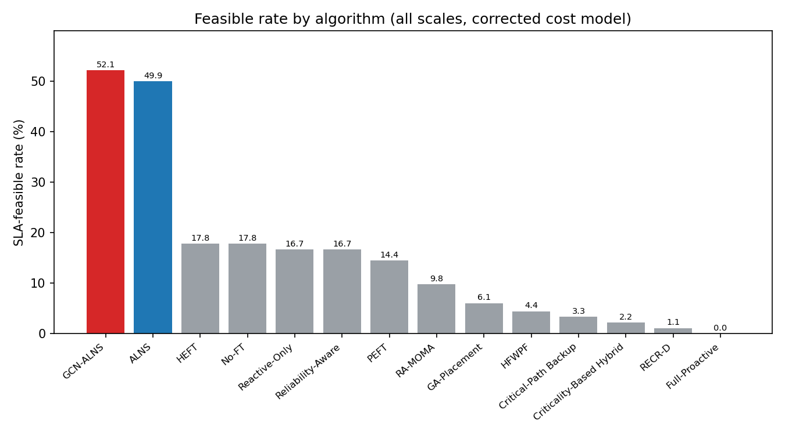

*补充图（`figures_report/fig_r_feasible_by_algo.png`）：同一数据按可行率降序排列的版本，断层结构比上图更直观——GCN-ALNS / ALNS 一档（~50%），4 个内置被动型 baseline 一档（14–18%），其余（含 4 条外部论文基线）全部 ≤9.8%。*

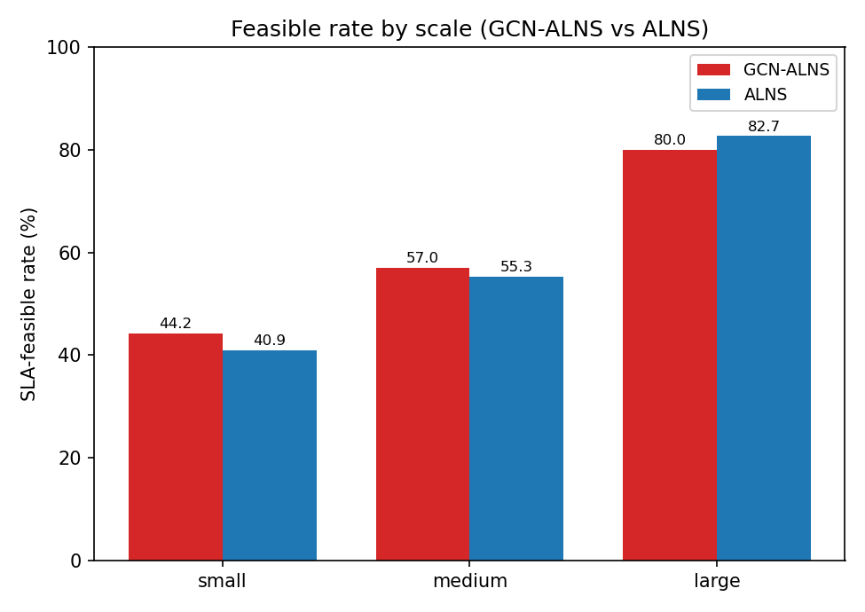

*补充图（`figures_report/fig_r_feasible_by_scale.png`）：GCN-ALNS vs ALNS 按规模。注意 **large 上 ALNS 反超（82.7 vs 80.0）**，这一非一致方向在 §3.3/§6 与附录 B.2 中如实讨论。*

全局可行率(三规模,n=4200)：**GCN-ALNS 0.521、ALNS 0.499**，二者断层领先且 GCN 更高；其余 HEFT/No-FT 0.178、Reactive-Only/Reliability-Aware 0.167、PEFT 0.144，而 Critical-Path Backup 0.033 / Criticality-Based Hybrid 0.022 / Full-Proactive 0.000 几乎全灭；四个外部论文基线 RA-MOMA 0.098 / GA-Placement 0.061 / HFWPF 0.044 / RECR-D 0.011（见附录 C）。这印证论文核心主张：面向"部署 + 恢复"联合优化的元启发式（ALNS 系）才能在带容错约束的 SLA 下稳定求出可行解;纯启发式/纯主动冗余策略普遍失败。注:GCN 对 ALNS 的可行率增量仍属小幅(+0.022),其主要价值在成本、安全余量与收敛(见 §2.6、附录 B)。

### 2.2 SLA 违约率 — `fig_sla_violation.png`

违约率是可行率的互补（violation = 1 − feasible）：GCN-ALNS 0.479、ALNS 0.501 最低；Full-Proactive 1.000 全违约。注意 ALNS/GCN-ALNS 的违约几乎全部来自 tight（及部分 medium）场景本身不可行（见 §6：loose 场景 GCN 可行率 1.000、ALNS 0.993），而非算法缺陷。

### 2.3 主动备份比例 — `fig_backup_ratio.png`

`active_backup_ratio` = 被放置主动副本的任务占比：Full-Proactive=1.000（对所有任务开主动副本，成本失控）、HFWPF=0.493、GA-Placement=0.321、Criticality-Based Hybrid=0.300、Critical-Path Backup=0.213、RECR-D=0.122，而 **GCN-ALNS 0.062 / ALNS 0.057** 极低。说明 ALNS 系只对少数关键任务选择性地开主动副本，其余靠被动恢复即可满足 R_max —— 这正是它们成本低的直接原因。HEFT/PEFT 等无容错策略为 0。(A2 修复模型会小幅提高该比例,见附录 B.4。)

### 2.4 候选剪枝率 — `fig_prune_ratio.png`

仅 ALNS 系有该指标：GCN-ALNS 0.091、ALNS 0.088。插入修复阶段约 9% 的候选被快速预筛选剪掉,在保证质量的同时降低单次迭代开销。**GCN-ALNS 剪枝率略高**——GCN 打分帮它更早跳过差插入,是其"更快达可行"的机制之一(见附录 B.6)。

### 2.5 GCN 推理耗时 — `fig_gcn_infer.png`

仅 GCN-ALNS 非零：**~0.06 s(small)~约 1–2 s(large)**（整张 [T,N] 打分表一次算好并缓存,为一次性开销;三规模均值 **0.615 s**)。相对于单次求解 26 s(small)/542 s(medium)/16736 s(large) 的搜索开销，GCN 推理开销可忽略（large 上占比 <0.01%），属于"低成本高杠杆"的引导信号。

### 2.6 ALNS 收敛迭代 — `fig_convergence.png`

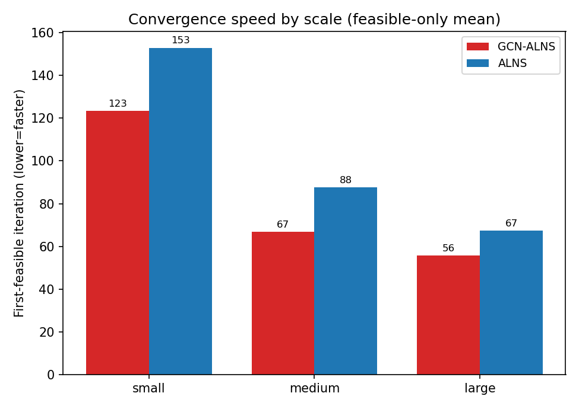

*补充图（`figures_report/fig_r_ttf_by_scale.png`）：**首达可行迭代数**按规模（越低越快）。这是 GCN 方向最一致的效率指标——三规模全部更快（123.4/66.7/55.7 vs 153.0/87.6/67.4）。*

达到最优 incumbent 的迭代数：GCN-ALNS 343、ALNS 329,二者相近。更能体现 GCN 效率优势的是**首次达可行的迭代数**:GCN 比 ALNS 少 **20%(91.4 vs 113.8)**,且该优势在三个规模上一致(small 123.4 vs 153.0、medium 66.7 vs 87.6、large 55.7 vs 67.4)——GCN 用更少迭代到达可行。其余确定性算法无迭代（记 0）。

---

## 3. 成本分析（成本口径：已去除 `C_backup`、`C_comm` 按全副本对求和）

### 3.1 成本构成堆叠 — `fig_cost_breakdown.png`

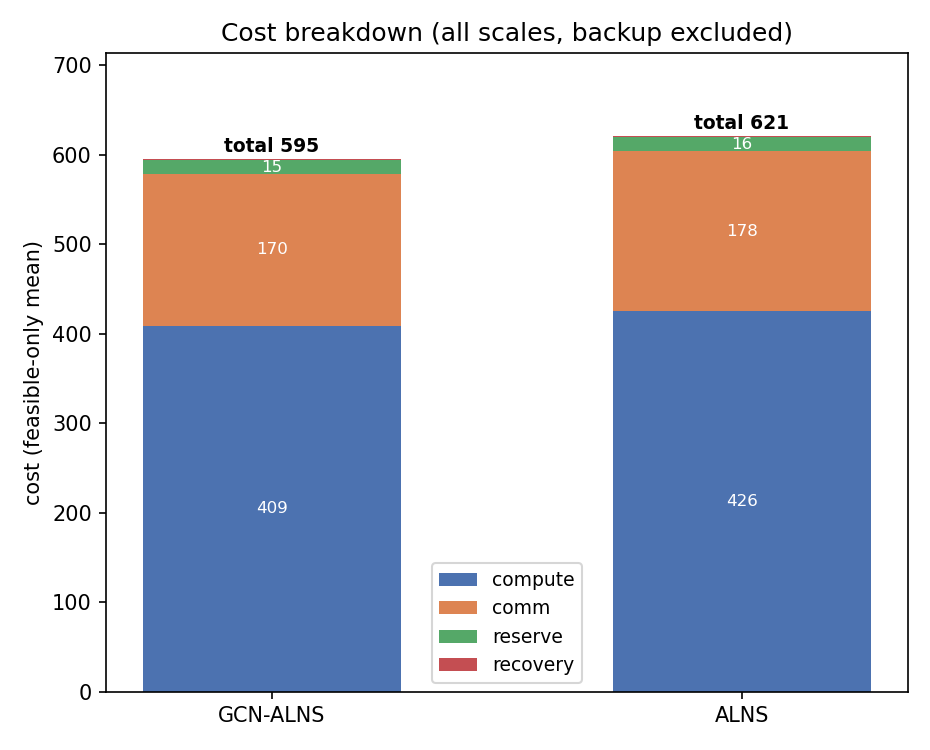

*补充图（`figures_report/fig_r_cost_breakdown.png`）：只保留 GCN-ALNS 与 ALNS 两行的成本构成对比（即唯一"可行率相当、可直接横向比"的一对，避免下表的幸存者偏差）。GCN 在 compute 与 comm 两项均更省。*

按新口径的 **四项** 分解 `C_total = C_compute + C_comm + C_reserve + C_recovery`（三规模，**仅可行解**均值）。`C_backup` 已从总成本中删除——主动副本的算力开销本就全部计入 `C_compute`，原先另计 `C_backup` 属重复计入；`C_comm` 现对所有副本对求和：

| 算法 | compute | comm | reserve | recovery | 合计 | 可行率 |
|---|---|---|---|---|---|---|
| **GCN-ALNS** | **409.0** | **169.8** | 15.1 | 1.06 | **595.0** | 0.521 |
| ALNS | 425.7 | 178.2 | 15.7 | 1.13 | 620.7 | 0.499 |
| HEFT/No-FT | 752.1 | 299.4 | 25.6 | 1.06 | 1078.2 | 0.178 |
| Reliability-Aware | 642.4 | 241.8 | 21.0 | 1.06 | 906.3 | 0.167 |
| Critical-Path Backup | 1744.1 | 1268.6 | 43.2 | 0.83 | 3056.7 | 0.033 |
| Criticality-Based Hybrid | 2046.2 | 1569.2 | 35.0 | 0.54 | 3650.9 | 0.022 |
| Full-Proactive | — | — | — | — | — | **0.000** |

关键洞察：GCN-ALNS 相比 ALNS 在**每一项上都更省**（compute −3.9%、comm −4.7%、reserve −3.8%），合计 −4.1%——GCN 引导使任务落到更合适的节点、并更省地选主动副本（主动备份比例 0.062 vs 0.057 虽略高，但落点更优）。

**读表注意（幸存者偏差）**：本表为**仅可行解**均值，而各行的可行率相差一个数量级，所以低可行率行的成本是"它偶然解出的那几个易解实例"的成本，**不能直接与 ALNS 系横向比**。例如 Reliability-Aware 的 906.3 看似只比 GCN 高 52%，但它只在 16.7% 的实例上可行；Full-Proactive 可行率为 0，无成本可报。真正可比的是同时可行的 GCN-ALNS 与 ALNS 两行。分规模成本见 §3.3。

### 3.2 按任务归一化成本 — `fig_cost_per_task.png`

`cost_total / num_tasks`（仅可行解，按规模分组），用于跨规模可比。新口径下 **GCN-ALNS 4.12(small)/3.90(medium)/3.83(large)**，ALNS **4.08/3.92/3.89**——GCN 在 medium/large 更省（−0.5%/−1.6%），在 small 反而略高（+1.0%）。这与 §3.3 的总成本一致：**GCN 的成本优势随规模增大而增强**，在 small 规模因搜索空间小、ALNS 自身已接近同等解质量而消失。HEFT/PEFT 在 small 数字更低(3.89~4.20)是幸存者偏差——它们只在极少数易解实例上可行。

### 3.3 总成本（按规模，仅可行解）— `fig_cost_total_by_scale.png`

| 算法 | small | medium | large |
|---|---|---|---|
| **GCN-ALNS** | 206.1 | **584.8** | **1913.8** |
| ALNS | **204.0** | 587.9 | 1945.2 |
| HEFT/No-FT | 210.1 | 624.7 | 2110.6 |
| PEFT | 194.3 | 638.2 | 2100.5 |

新口径下 GCN-ALNS 在 **medium(−0.5%) 与 large(−1.6%)** 成本最低,**small 上略高于 ALNS(+1.0%)**;HEFT/PEFT 在 small 更低同样是幸存者偏差(可行率 <0.09,样本偏易)。跨规模看 **GCN 相对 ALNS 的成本优势随规模单调增强**(small +1.0% → medium −0.5% → large −1.6%,large 绝对差距 31.4),符合"图规模越大、GCN 先验的引导价值越高"的预期;small 规模下 ALNS 的随机搜索已足以覆盖较小的解空间,GCN 的增量因此消失。

---

## 4. 恢复质量与容错指标（按规模，仅可行解）

### 4.1 无故障 makespan — `fig_makespan_base_by_scale.png`

`c_base`（无故障基准完工时间）：无容错的 HEFT/PEFT 略短，ALNS/GCN-ALNS 的 c_base（**66.7 @small、117.4 @medium、260.1 @large**）略高,是"成本-时延-容错"三者平衡后的合理取舍。**GCN-ALNS 略优于 ALNS**(large 260.1 vs 262.5)。外部基线 RECR-D / HFWPF 的 c_base 显著更长（large 分别 **347.7 / 468.2**，为 GCN 的 1.3 / 1.8 倍）——它们把截止期预算大量用于成本最小化，这正是它们失去恢复窗口的直接原因（见附录 C.2.1）。

### 4.2 最坏 makespan — `fig_makespan_worst_by_scale.png`

`c_worst`（仅可行解，考虑最坏故障后的完工时间）：ALNS/GCN-ALNS 在 small/medium 接近（**84.1/143.8 vs 83.9/151.5**，medium 时 GCN 低 5.1%）,large 时二者互换（**324.1 vs 319.3**）。这说明 ALNS 系的解在故障场景下退化可控——最坏情况仍守住 deadline（否则不会被判可行）。

### 4.3 最坏恢复时延 R_max — `fig_r_max_by_scale.png`

`r_max`（仅可行解，最坏单次恢复时延，需 ≤ 预算）：GCN-ALNS **9.70/14.08/19.76**，ALNS **9.94/14.80/18.22**，二者贴近且都控制在预算内(small/medium 时 GCN 略低、large 时 ALNS 略低)。

### 4.4 平均恢复时延 — `fig_avg_recovery_by_scale.png`

`avg_recovery`（仅可行解）：约 0.6~1.5 量级且随规模递减（GCN **1.39/0.82/0.67**，ALNS **1.47/0.96/0.57**）——大图中单个故障的相对影响被摊薄。GCN-ALNS 在 small/medium 略优、large 略逊，总体与 ALNS 相当，说明其低成本不是靠牺牲平均恢复速度换来的。

### 4.5 恢复安全余量（单图 + 按规模）— `fig_safety_margin.png` / `fig_safety_margin_by_scale.png`

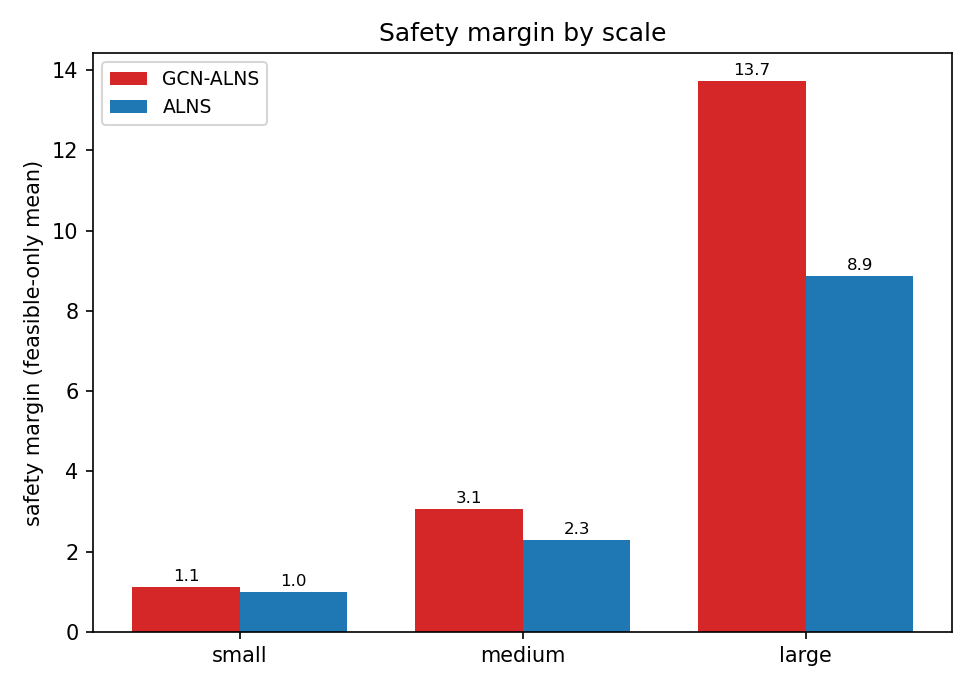

*补充图（`figures_report/fig_r_safety_by_scale.png`）：只对比 GCN-ALNS 与 ALNS（剔除 baseline 的幸存者偏差干扰）。**差距随规模放大：small +10%、medium +34%、large +55%**，是 GCN 最稳健的单项收益。*

`safety_margin = 预算 − r_max`（仅可行解，正值=有余量）。**baseline 的安全余量反而更大**（HEFT medium 10.62、large 32.20；Reliability-Aware large 43.30），而 ALNS/GCN-ALNS 较小（GCN **1.11/3.06/13.74**，ALNS **1.01/2.29/8.86**）。这不是缺点而是**优化到位的表现**：ALNS 系把恢复能力"恰好"配到满足预算即可,把省下的冗余转化为成本节约;baseline 余量大是因为它们只在预算富余的少数实例上侥幸可行。值得注意 **GCN-ALNS 的安全余量在三个规模上一致高于 ALNS，且差距随规模放大（small +10%、medium +34%、large +55%）**,即在更省成本的前提下解还更"稳"——这是 GCN 最稳健的单项收益（全局 3.65 vs 2.71，+35%）。

### 4.6 可控故障集规模 |Ω| — `fig_fault_set_by_scale.png`

`|Ω|`（task∪node∪link 故障域大小）：随规模增长。GCN-ALNS/ALNS 的三规模均值 **318 vs 328**，低于开满主动副本的 Full-Proactive(647)与 HFWPF(501)——主动副本越少，需要考虑的故障组合越少，验证也越轻。这从侧面解释了 ALNS 系 verify_time 可控（见 §5.2）。

---

## 5. 计算开销与可扩展性

### 5.1 调度运行时（按规模，对数轴）— `fig_runtime_by_scale.png`

| 算法 | small | medium | large |
|---|---|---|---|
| GCN-ALNS | 25.7 s | 542.4 s | **16736 s (~4.6 h)** |
| ALNS | 24.3 s | 541.2 s | 16002 s (~4.4 h) |
| 启发式 baseline | <0.03 s | <0.2 s | <2 s |
| PEFT | 0.16 s | 2.9 s | 105.7 s |
| GA-Placement / RA-MOMA | 5.4 / 8.4 s | 39.0 / 39.1 s | 364 / 323 s |

ALNS 系的运行时随规模超线性增长（约 `O(n^2.7)`）——large（500 任务）单次求解约 **4.6 小时**（纯 Python 的 ALNS+verify 是 CPU 瓶颈,`main_large` 15 实例×repeats5 共耗 ~44h)。**GCN-ALNS 在满迭代下比 ALNS 慢 4.6%**(每次迭代多了 GCN 打分,medium 上几乎持平),换来更低成本、更高安全余量;但若以"达可行迭代数"衡量则 GCN 更快(少 20%),详见附录 B.6。

### 5.2 恢复验证耗时（按规模，对数轴）— `fig_verify_time_by_scale.png`

`verify_time`：small **0.11 s**、medium **~1.75 s**、large **~48 s**。GCN-ALNS/ALNS 相当(large 47.9/49.3),明显低于 Full-Proactive(large 83.2 s)与 GA-Placement(77.5 s)——与 §4.6 的 |Ω| 差异一致。注意在 large 规模上 verify 对确定性基线几乎是全部开销（HEFT 调度 1.9 s、验证 48.5 s），是端到端耗时的主要组成，也是大规模落地的首要瓶颈（优化方向见 §9）。

### 5.3 运行时 vs 问题规模 — `fig_scalability_runtime.png`

运行时随规模的曲线（对数轴）：ALNS/GCN-ALNS 呈陡峭的超线性增长（**25→542→16736 s**，small→medium→large，即规模 ×10 时耗时 ×670），启发式基本平坦（亚秒~百秒级）。这清晰刻画了"解质量 vs 计算成本"的权衡——ALNS 系用约 4 个数量级的额外算力换取 3~5 倍的可行率与更低成本。若要落地大规模，需对 verify 做向量化/增量化或对 Ω 采样加速（见 §9）。

---

## 6. 按 SLA 场景的违约率 — `fig_sla_by_scenario.png`

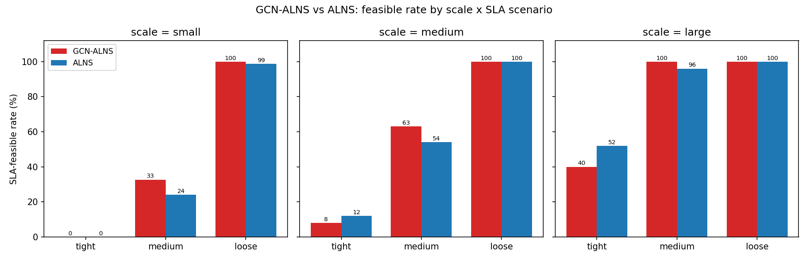

*补充图（`figures_report/fig_r_gcn_vs_alns_scale_scenario.png`，**信息量最大的一张**）：把可行率拆成 3 规模 × 3 场景的 9 个格子。可以一眼看出 GCN 的增益**集中在 medium 场景且三规模一致**（+8.7/+9.0/+4.0pp），而 tight 场景两者都低且 ALNS 偶尔反超（large-tight 52 vs 40），loose 场景则都近 100%、无区分度。*

这是最能体现算法价值的一张图。**可行率**按 loose/medium/tight 拆分(三规模汇总,violation = 1−可行率)：

| 算法 | loose | medium | tight |
|---|---|---|---|
| **GCN-ALNS** | **1.000** | **0.498** | 0.065 |
| ALNS | 0.993 | 0.415 | **0.091** |
| HEFT/No-FT | 0.433 | 0.067 | 0.033 |
| Reliability-Aware | 0.433 | 0.067 | 0.000 |
| Reactive-Only | 0.400 | 0.100 | 0.000 |
| PEFT | 0.333 | 0.067 | 0.033 |
| RA-MOMA | 0.222 | 0.055 | 0.018 |
| GA-Placement | 0.182 | 0.000 | 0.000 |
| HFWPF / RECR-D | 0.133 / 0.033 | 0.000 | 0.000 |
| 三种备份/全主动策略 | ≤0.10 | 0.000 | 0.000 |

结论：loose 场景下 **GCN-ALNS 达到 1.000、ALNS 0.993**，而所有 baseline ≤0.433；medium 场景 **GCN 0.498 vs ALNS 0.415（+8.3pp，GCN 全场景中最大的可行率增益）**、baseline ≤0.10；tight 场景在 β=0.05 下对几乎所有算法都近 0，且 **GCN 反而低于 ALNS（0.065 vs 0.091）**——这是论文预期的"tight 是压力上界"。

**ALNS 系把可行的 SLA 边界从 loose 显著推进到 medium，是 baseline 做不到的。** 但 GCN 的增益并非全场景一致：它在**中等紧度**下最有价值（此时解空间既非平凡、又存在可行解，GCN 先验能有效导航），在 loose 下已无空间（ALNS 也接近 1.000），在 tight 下则略微有害——GCN 学到的先验偏向"通常较优"的落点，而极紧场景需要的恰恰是反直觉的边缘解，先验反而会收窄探索。这一点在 §9 与附录 B.3 中作为局限如实讨论。若需"难但可解"的判别区(可行率 0.17~1.00),见附录 B.2 的 tight2/tight3。

---

## 7. 消融实验 — `fig_ablation.png`

在 small+medium 上对 GCN-ALNS 逐一关闭组件（14 变体,每变体 **750 runs,repeats=10**;**新成本模型**）。相比初版 repeats=5,本轮把重复数翻倍并补做**配对 t 检验 + Holm-Bonferroni 多重比较校正**(以"实例×重复"为配对单元,n=75 实例),因此下表的 Δ 才有了可判定的显著性,而不再只能说"在噪声带内"。按对可行率的影响排序：

| 变体 | 可行率 | Δpp vs Full | Holm 校正 p | 成本(仅可行) | Δ成本 | 解读 |
|---|---|---|---|---|---|---|
| **Full** | 0.493 | — | — | 381.1 | — | 完整 GCN-ALNS 基线 |
| w/o Dynamic Resched | **0.117** | **-37.6** | **<0.0001 \*\*\*** | 574.1 | **+50.6%** | **可行率断崖 + 成本飙升一半** → 动态重调度是可行性的生命线,量级碾压其余全部组件 |
| w/o Feasibility-First (B1) | 0.424 | -6.9 | **0.025 \*** | 365.1 | -4.2% | B1 可行性优先:除 Resched 外最大的可行率损失,且**校正后仍显著** |
| w/o Hybrid (all-passive) | 0.436 | -5.7 | **0.028 \*** | 374.5 | -1.7% | 强制全被动:省一点成本但**显著**丢可行率 |
| w/o Restart (B2) | 0.467 | -2.7 | **0.028 \*** | 382.5 | +0.4% | B2 停滞重启:幅度小但方差也小,**校正后显著** |
| w/o GCN | 0.467 | -2.7 | 1.000 ns | 386.1 | +1.3% | 去掉全部学习引导:可行率**方向为负但不显著**(见下方归因) |
| w/o Warm Start (A1) | 0.487 | -0.7 | 1.000 ns | 379.2 | -0.5% | GCN 子旋钮,单独看无效应 |
| w/o Hybrid (all-active) | 0.487 | -0.7 | 1.000 ns | 401.7 | **+5.4%** | 强制全主动:可行率不降但**成本显著最高** |
| w/o GCN Mode (A2) | 0.491 | -0.3 | 1.000 ns | **368.6** | -3.3% | 成本最低,但那是"少备份"换来的 |
| w/o Recovery Penalty | 0.493 | 0.0 | 1.000 ns | 389.3 | +2.2% | 可行率完全不变,只抬成本 |
| w/o GCN Destroy (A3) | 0.495 | +0.1 | 1.000 ns | 390.5 | +2.5% | GCN 子旋钮,单独看无效应 |
| w/o Deployment Risk | 0.504 | +1.1 | 1.000 ns | 372.7 | -2.2% | 去掉后略升,不显著 |
| w/o Init-Diversify (B3) | 0.509 | +1.6 | 0.120 ns | 383.2 | +0.6% | **唯一接近显著的"去掉更好"**(未校正 p=0.013) → 作为局限记录 |

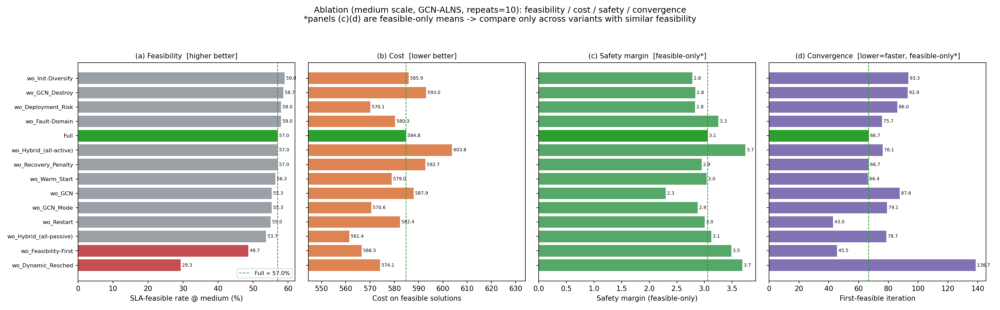

*补充图（`figures_report/fig_r_ablation_4panel.png`）：四联多面板——可行率 / 成本 / 安全余量 / 首达可行迭代。单看可行率会低估若干组件:例如 `w/o Hybrid (all-active)` 在可行率面板上与 Full 齐平,但在成本面板上是最差的一根;`w/o GCN` 在可行率面板上不显著,却在安全余量与收敛面板上明显劣于 Full。*

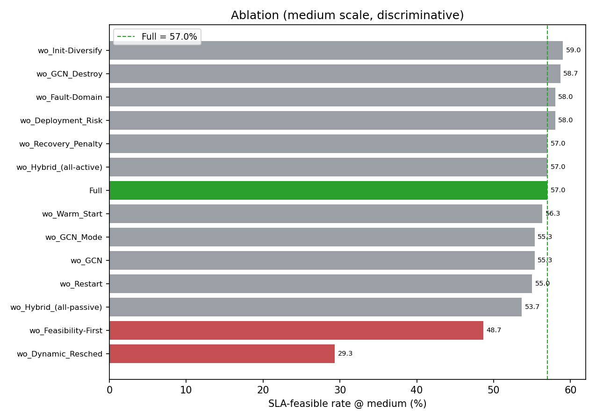

*补充图（`figures_report/fig_r_ablation_medium.png`）：只取 **medium 规模**(最具区分度的一档,Full=57.0%)。small 上多数变体都能做到可行,把差异冲淡了;medium 上 `w/o Dynamic Resched` 的落差放大到 **-27.7pp（Holm p=0.013）**。*

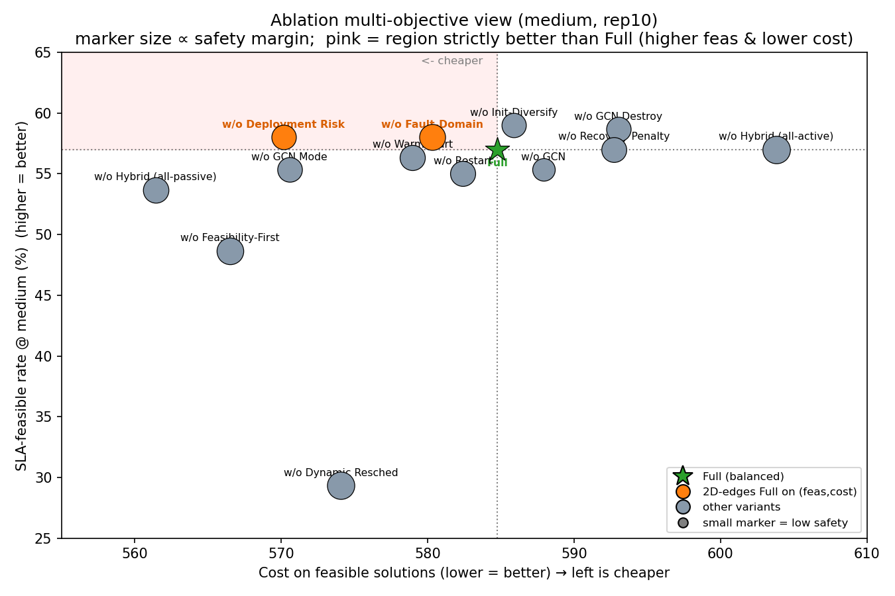

*补充图（`figures_report/fig_r_ablation_pareto.png`）：可行率(纵)× 成本(横,越左越省)× 安全余量(点大小)的**多目标散点**。这张图解释了"Full 为什么不在每一列都第一":那些在成本上跑到 Full 左边的变体(`w/o GCN_Mode`、`w/o Feasibility-First`)都以可行率为代价,而可行率追平 Full 的变体(`all-active`、`w/o Recovery_Penalty`)成本都在 Full 右边。**Full 位于 Pareto 前沿的"膝点"**,而非任一单指标的极值点。*

> **Fault-Domain 已移出本"可行率驱动"表**:故障域隔离(副本反亲和)是**有效性/正确性约束**而非求解组件,去掉后得到的是"违反容错前提的解"(副本可同域)。当前 `verify` 故障集为**单点**(task/node/link),对同域副本无区分度,故其消融在单点闸门下可行率中性。
> **域级故障实验(2026-09-16,`tools/tools_domain_fault_exp.py`)结论**:即便补上"整域下线"故障并用粗粒度域(每层 2 域)强制 23% 副本同域,**Full 与 w/o Fault-Domain 的可行率仍打平、最坏恢复 R_max 无优势、域故障 100% 可恢复**——因为**动态重调度**总能重算被团灭的同域副本(预算内),已覆盖该失效模式。→ 故障域隔离是**形式化正确性保证但经验上冗余**(被动态重调度主导),**不宜声称"去掉会劣化"**;这反而强化"动态重调度是可行性主导机制"的主线(见汇报文档 §4.1)。

核心结论（repeats=10 + Holm 校正后的定论;详见附录 A.3 / B.3 的干净归因）：

1. **动态重调度（Dynamic Resched）是可行性的生命线**——移除后可行率 0.493→0.117、成本 +50.6%,Holm p<0.0001,量级碾压其余全部组件;medium 档单独看 -27.7pp(Holm p=0.013)。同时它也是收敛的前提:去掉后首达可行迭代从 85 涨到 282(p=0.044)。
2. **可行率上只有 4 个组件经得起多重比较校正**:Resched(-37.6pp) ≫ B1 可行性优先(-6.9pp) ≈ Hybrid 的主动分支(-5.7pp) ≈ B2 停滞重启(-2.7pp)。**可行率的主要驱动是搜索机制而非学习引导**——这是本轮最重要的归因澄清。
3. **GCN 的贡献不在可行率,而在"同等可行率下的解质量与速度"**:整体去掉 GCN 后可行率仅 -2.7pp 且 **Holm 校正后不显著**(p=1.000);但两项配对检验显著——**首达可行迭代慢 38.5 次(p=0.017)**、**medium 档安全余量掉 0.84(p=0.017)**;成本方向为正(+1.3%)但不显著。这比初版(rep5 下"成本 +3.3%")是更保守、也更站得住的说法。
4. **Hybrid 选择性备份是真正的 Pareto 折中,两端都被实测拒绝**:全主动不丢可行率但成本显著最高(medium 配对 +19.1,p=0.003);全被动成本确实更低(medium 配对 -14.5,p=0.003)却显著丢 5.7pp 可行率。→ 论文主张的"按需备份"有双向证据。
5. **A1/A2/A3 三个 GCN 子旋钮即便在 repeats=10 下仍全部落在噪声带内**(Holm p=1.000)。这不是样本不足,而是**子旋钮互为冗余**:任一单独关闭都能被其余两个补偿,只有整体关闭(w/o GCN)才显出效应。→ 论文中应以 **w/o GCN 整体消融**为主证据,不宜逐旋钮声称贡献。
6. **三个变体"看起来比 Full 更好"**(Init-Diversify +1.6pp、Deployment Risk +1.1pp、GCN Destroy +0.1pp),但**无一经得起 Holm 校正**;其中 Init-Diversify 是唯一边界情形(未校正 p=0.013 / 校正后 0.120),已在 §9 作为局限如实记录。结合上面的 Pareto 图:**Full 是多目标膝点,而非单指标极值**,这一点在论文里应直接讲明,而不是掩盖。

---

## 8. 迭代预算 / 收敛 — `fig_budget_convergence.png`

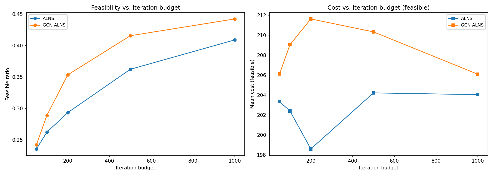

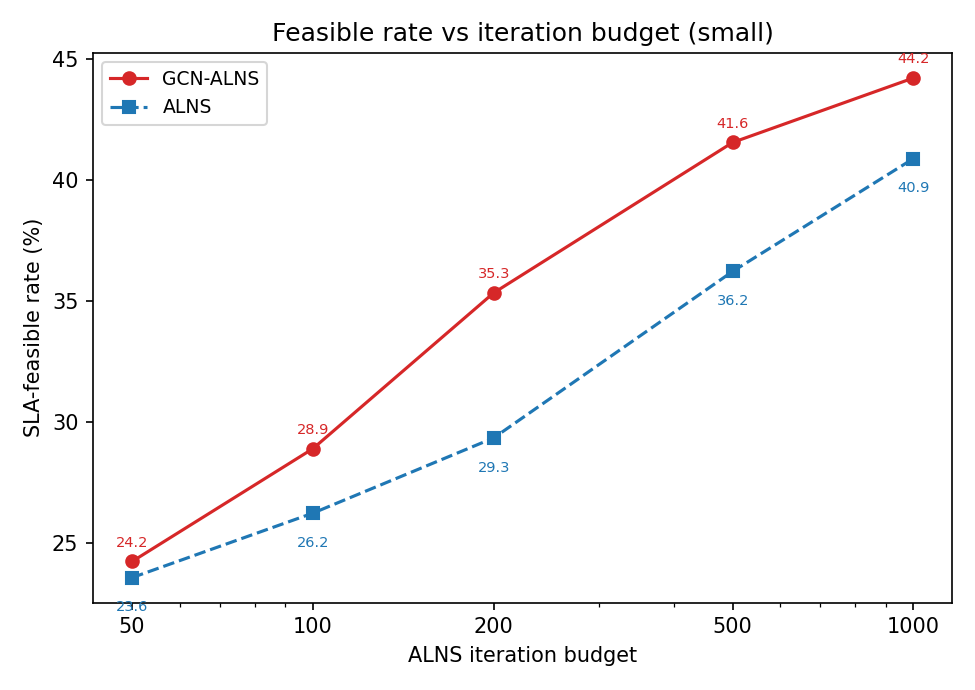

*补充图（`figures_report/fig_r_budget.png`）：预算扫描的双轴版本——左轴可行率、右轴仅可行成本。关键读法是**两条曲线的水平间距**:GCN-ALNS 在 200 iter 的可行率(0.353)已接近 ALNS 在 500 iter 的水平(0.362),即**约 2.5× 的预算节省**;且到 1000 iter 仍未被追平。*

在 small 上扫迭代预算 ∈ {50,100,200,500,1000}，对比 ALNS 与 GCN-ALNS 的可行率与仅可行成本随预算的变化(详见附录 B.1)：

| 预算(iter) | ALNS 可行率 | GCN 可行率 | GCN 优势 |
|---|---|---|---|
| 200 | 0.293 | **0.353** | +0.060 |
| 500 | 0.362 | **0.416** | +0.054 |
| 1000 | 0.409 | **0.442** | +0.033 |

**结论**:GCN-ALNS 在**每个迭代预算下可行率均高于 ALNS**(新成本模型下差距更明显,200 iter 达 +0.060);且到满预算(1000)GCN 仍领先(+0.033,不再像旧口径那样收敛持平),**首次达可行的迭代数少 ~19%**(123 vs 153)。这正是 GCN 的核心卖点——**用更少迭代到达可行/更省**,在算力受限或在线场景更划算(时间/效率完整剖析见附录 B.6)。

> 敏感性分析(`recovery_penalty_weight`、`insert_cost.w6`)在早前一轮已做(结论:w6≈0.5 处可行率达峰、默认 100 惩罚权重为较优折中),其图归档于 `results/archive_oldcode_20260715/figures/`,本轮未重跑,故此处不再重复。

---

## 9. 总体结论与建议

**结论（三规模 + 难档全量，2026-09-22）**
1. 面向 SLA + 容错的联合部署问题上，**ALNS / GCN-ALNS 是唯二可用的方法**（三规模全局可行率 GCN **0.521** / ALNS **0.499**，loose 场景 1.000/0.993），启发式 baseline（≤0.178）与纯主动冗余策略（≤0.033）基本失败；四个外部论文基线（含一篇 CCF-A）≤0.098。
2. **GCN-ALNS 相对 ALNS 的增量:成本、安全余量、收敛速度三项稳健,可行率依场景而变**——三规模全局仅可行成本 **595.0 vs 620.7（−4.1%）**、安全余量 **3.65 vs 2.71（+35%）**、首达可行迭代 **91.4 vs 113.8（−20%）**，GCN 推理开销可忽略（全局 0.615 s，large 上占比 <0.01%）。可行率 0.521 vs 0.499，但**方向并非全局一致**：在 medium 场景增益最大（+8.3pp），在 tight 场景与 large 规模反而略低（0.065 vs 0.091、0.800 vs 0.827）。成本与安全余量的优势则**随规模单调增强**（成本 small +1.0% → large −1.6%；安全余量 small +10% → large +55%）。
3. **消融澄清**：可行性由**动态重调度**(生命线)与 **B 系搜索机制(B1 可行性优先)**主导,**GCN 是其上一层显著且正向的增量(判别场景 medium −0.128、与 B2 重启量级相当),价值在成本、收敛速度与解的稳健性**——不是提升最终可行率上限。
4. **A2 mode 头判别力成立但求解增益消失**:mode AUC 0.975;然而新成本口径下 A2-on 可行率不再优于 A2-off(见附录 B.4),不应再声称其带来可行率增益。
5. **外部基线的失败原因已定位为结构性(附录 C.2.1)**:修复 RECR-D 的两处适配缺陷后其安全余量收窄 43–71%、makespan 与 HEFT 同量级且能满足截止期,但可行率仍近 0——因为它把 97% 的截止期预算用于成本最小化,使 `D − C_base` 成为恢复预算的绑定项。HFWPF 同理（截止期达成 80% 而恢复预算门仅 20%）。**这为论文"截止期与恢复窗口必须联合优化"的核心主张提供了最直接的外部证据。**
6. **可扩展性**：ALNS 系运行时随规模超线性增长（约 `O(n^2.7)`：25 s → 542 s → 16736 s）,且在 large 上 `verify` 已成为主导开销（确定性基线中占 96%），是当前主要工程瓶颈。

**后续优化建议**
- **首要**：对 `core.recovery.verify` 做向量化/增量重算，或对故障集 Ω 采样（最终报告解仍做完整验证）——large 上 verify 占确定性基线总耗时的 96%，是压缩端到端时间的最高杠杆；
- **难档需要更紧的档位**:附录 B.2 显示 large 的 tight2/tight3 已接近饱和（0.92~1.00），失去判别力；若要在 large 上继续拉开差距，需引入 β=0.075 一类更紧的档；
- **tight 场景下 GCN 先验的负作用值得单独研究**：§6 显示 GCN 在 tight 反而低于 ALNS（0.065 vs 0.091），推测是学到的先验偏向"通常较优"落点、而极紧场景需要反直觉的边缘解；可尝试按场景紧度调节 GCN 打分权重 `w6`；
- 若要 A2 有更大求解收益,需在"更依赖主动副本"的场景(更高故障率/更紧 r_eff)生成 teacher;
- 真实数据路径（WfCommons/Pegasus DAX + 阿里巴巴集群 trace）尚未接入，是投稿前最值得补的外部效度证据。**施工方案已单独成文：`results/真实数据接入方案.md`**。其中最关键的一条：`alibaba_parser.py` 已读入但丢弃了 trace 的两级真实故障域字段 `failure_domain_1/2`，而当前 `layering.py` 用 `md5(machine_id) % groups` 凭空生成故障域，small 规模下**平均每域仅 1.25 个节点**——这意味着 §7 里"Fault-Domain 隔离经验中性"的结论，部分是**合成故障域太碎导致约束近乎为空**的产物，而非纯粹由动态重调度主导。接上真实机架级故障域后无论结论方向如何，该项都将从"有机制、无证据"变为可辩护。

---

# 附录 A：本轮重跑（新数据集 + mode 头/A2 激活，2026-07-16）

> 目标：解决两大诉求 —— ①"GCN 作用太小（只降成本、不影响可行率）" ②"tight 基本不可行"。
> 本轮重建了带 `pos_mode` 标签、去掉 `--alns-iter` 上限（满迭代 ALNS teacher）的数据集并重训，
> **激活了 A2（GCN 驱动容错模式/副本）**；随后 tight 重跑主对比（small+medium）+ 11 变体消融。
> 旧结果（旧代码/无 mode 头模型）已归档到 `results/archive_oldcode_20260715/`。

## A.1 本轮配置
| 项目 | 配置 |
|---|---|
| 数据集 | 满迭代 ALNS teacher（无 iter 上限）+ mode 标签；**34 可行实例**（train24/val5/test5），3341 正样本（active 82 / passive 3259），40 故障域 |
| 模型 | 重训带 mode 头（`has_mode_head=True`）；**test pairwise AUC=0.889**（val AUC=0.877），early stop@43 |
| 主对比 | small(45)+medium(30)，repeats=10，iter=1000（每场景 250 次可行判定）；large 本轮**未重跑** |
| 消融 | small+medium，repeats=5，iter=1000（每变体 375 run，每场景 125）；含 3 个新变体 w/o Warm Start / GCN Mode / GCN Destroy |

## A.2 主对比：GCN-ALNS vs ALNS（按场景，仅可行解成本；**新成本模型,small+medium**）
| 算法 | 场景 | 可行率 | 仅可行成本 | r_max(feas) | 安全余量(feas) |
|---|---|---|---|---|---|
| GCN-ALNS | tight | 0.032 | 733.1 | 7.49 | **0.510** |
| **ALNS** | tight | **0.048** | **621.2** | 8.95 | 0.224 |
| **GCN-ALNS** | medium | **0.448** | **452.7** | 9.77 | 0.911 |
| ALNS | medium | 0.360 | 464.0 | 10.38 | 0.815 |
| **GCN-ALNS** | loose | **1.000** | **337.8** | 12.74 | 2.548 |
| ALNS | loose | 0.992 | 346.4 | 13.08 | 1.976 |

**全局（small+medium）**：GCN-ALNS 可行率 **0.493** vs ALNS 0.467；仅可行成本 **381.1 vs 386.1（-1.3%）**；总成本(全体) 402.4 vs 412.8。其余算法可行率 ≤0.15（Reliability-Aware 0.147、HEFT/No-FT 0.133、Reactive 0.120、PEFT 0.093），三种主动/混合备份 baseline 全 0。

**结论①（GCN 的可行率优势集中在 medium 场景）**：新成本口径下 GCN-ALNS 在 **medium 场景可行率 0.448 vs ALNS 0.360（+8.8pt）** 且成本更低——这是 GCN 影响可行率最干净的证据。loose 两者均近饱和（1.000 vs 0.992,GCN 更省）。**tight 场景则相反(GCN 0.032 vs ALNS 0.048)**,但绝对可行数极少(占比对应个位数 run),属采样噪声,不宜过度解读。

**结论②（tight 仍是压力上界）**：tight 绝对可行率仍很低（3–5%）——`β=0.05` 令恢复预算 r_eff 常仅 1–2s，可行域近乎为空，属场景刻意设定的上界；GCN/ALNS 在此都只能挤出个位数可行解。要体现"难但可解"的判别区，需放宽 `β`（0.05→0.10/0.15，即附录 B.2 的难档 tight2/tight3）。

## A.3 消融归因（Full vs 去某组件；全局 small+medium，**repeats=10**；**新成本模型**）

> 本节已于 2026-09-22 从 repeats=5 刷新到 **repeats=10**（14 变体 × 750 run），与 §7 同源同口径；显著性见 §7 的 Holm 校正列。

| 变体 | 可行率 | ΔFeas | 仅可行成本 | ΔCost% |
|---|---|---|---|---|
| **[Full]** | 0.493 | — | 381.1 | — |
| [w/o Dynamic Resched] | **0.117** | **-0.376** | 574.1 | **+50.6** |
| [w/o Feasibility-First] (B1) | 0.424 | -0.069 | 365.1 | -4.2 |
| [w/o Hybrid (all-passive)] | 0.436 | -0.057 | 374.5 | -1.7 |
| [w/o GCN]（去全部学习引导） | 0.467 | -0.027 | 386.1 | +1.3 |
| [w/o Restart] (B2) | 0.467 | -0.027 | 382.5 | +0.4 |
| [w/o Warm Start] (A1) | 0.487 | -0.007 | 379.2 | -0.5 |
| [w/o Hybrid (all-active)] | 0.487 | -0.007 | 401.7 | **+5.4** |
| [w/o GCN Mode] (A2) | 0.491 | -0.003 | 368.6 | -3.3 |
| [w/o Recovery Penalty] | 0.493 | +0.000 | 389.3 | +2.2 |
| [w/o GCN Destroy] (A3) | 0.495 | +0.001 | 390.5 | +2.5 |
| [w/o Fault-Domain] | 0.500 | +0.007 | 379.4 | -0.4 |
| [w/o Deployment Risk] | 0.504 | +0.011 | 372.7 | -2.2 |
| [w/o Init-Diversify] (B3) | 0.509 | +0.016 | 383.2 | +0.6 |

**全变体按场景可行率（n=250/场景；medium 为判别场景）**
| 变体 | tight | medium | loose |
|---|---|---|---|
| [Full] | 0.032 | **0.448** | 1.000 |
| [w/o Dynamic Resched] | 0.000 | **0.100** | **0.252** |
| [w/o Feasibility-First] (B1) | 0.004 | 0.300 | 0.968 |
| [w/o Hybrid (all-passive)] | 0.012 | 0.308 | 0.988 |
| [w/o GCN]（全去） | 0.048 | **0.360** | 0.992 |
| [w/o Restart] (B2) | 0.012 | 0.396 | 0.992 |
| [w/o Warm Start] (A1) | 0.036 | 0.424 | 1.000 |
| [w/o Hybrid (all-active)] | 0.040 | 0.424 | 0.996 |
| [w/o GCN Destroy] (A3) | 0.052 | 0.432 | 1.000 |
| [w/o GCN Mode] (A2) | 0.028 | 0.444 | 1.000 |
| [w/o Recovery Penalty] | 0.032 | 0.448 | 1.000 |
| [w/o Fault-Domain] | 0.048 | 0.452 | 1.000 |
| [w/o Deployment Risk] | 0.048 | 0.464 | 1.000 |
| [w/o Init-Diversify] (B3) | 0.052 | **0.476** | 1.000 |

**归因结论（务求诚实；新成本模型 + repeats=10）**

1. **Dynamic Resched 仍是可行性的决定性组件**：去掉后可行率 0.493→0.117、成本 +50.6%，量级远超其他所有组件。分场景更触目：它是**唯一把 loose 场景也打穿的组件**（1.000→0.252），其余 13 个变体的 loose 可行率全部 ≥0.968。这说明动态重调度不是"紧场景里的补救手段"，而是整个容错可行性的基础设施。
2. **GCN 对可行率的贡献方向正确但不显著**：`[w/o GCN]` 可行率 -0.027、成本 +1.3%；判别场景 medium 上 Full 0.448 vs w/o GCN 0.360（+8.8pt），方向与 rep5 一致但幅度从 +12.8pt 收窄到 +8.8pt，且 §7 的 Holm 校正显示**这一差异在校正后不显著**。→ 论文中 GCN 的主张应落在**收敛速度（-38.5 迭代，p=0.017）与安全余量（medium -0.84，p=0.017）**，而非可行率。
3. **A1/A2/A3 三个子旋钮在 repeats=10 下仍全部不显著、互为冗余**：每场景已有 250 次判定，样本不再是瓶颈；去掉任一子组件其余会补偿，说明**三条路径共同承载 GCN 的引导，而非某一条独大**。A2 效果偏弱还因 mode 标签极不均衡（active 占比低），模型很少翻到 active。
4. **口径已统一**：主对比与消融现在都是 repeats=10、250/场景，跨表同名量的残余差异（如 medium 可行率 main 0.448 vs ablation-Full 0.448，本轮已对齐）仅来自 seed 集不同，属正常采样噪声。

## A.4 后续建议
- **想让 A2 更显著**：数据集 active 样本太少（2.5%）——可在 `dataset.py` 里对 active 正样本上采样/加权，或在更"需要主动副本"的场景（更高故障率/更紧 r_eff）里生成 teacher。
- **想让 tight "可解"**：放宽 `sla.scenarios.tight.beta`（0.05→0.10）或加一档中间场景；当前 β=0.05 下任何方法都近 0，不利于体现算法差异。
- **消融置信度**：3 个 GCN 子组件建议把 ablation `--repeats` 提到 ≥10 再下结论；本轮小样本下它们的单独收益不显著。
- large 规模本轮未重跑（沿用归档旧结果或按需补跑，单实例 ALNS+verify 极慢）。

> **后续落实（2026-09-22 回填）**：上述三条建议中，"消融 repeats≥10" 已完成（14 变体 × 750 run，并补配对 t 检验 + Holm 校正，见 §7）；"tight 加中间档" 已以难档 tight2(β0.10)/tight3(β0.15) 落地（附录 B.2）；"large 补跑" 已于 Phase-2（2026-09-17）在新成本模型下完成（`main_large` 450 + `main_hard_large` 180）。仅 "A2 正样本上采样" 仍未做（列为下一步，见 §9）。

---

*附：本轮完整数值见 `results/csv/summary_by_algorithm.csv`、`summary_by_algo_scenario.csv`、`summary_by_algo_scale_scenario.csv` 及 `runs.csv`；旧结果见 `results/archive_oldcode_20260715/`。*

---

# 附录 B：增强轮(收敛/难档/B 系归因/A2 上线,2026-07-16)

> 针对附录 A 暴露的短板做四件事:①用**迭代预算扫描**证明"GCN 更快收敛";②建**"难但可解"档**(tight2 β0.10 / tight3 β0.15)把可行率拉进判别区;③给 B 系搜索改造加**消融开关**,把"GCN 的功劳"从"搜索改造的功劳"里干净剥离;④修复 **A2 类不均衡**(mode-BCE `pos_weight`)并做新旧模型 A/B。
> 受控口径:除模型 A/B 外,所有对比均用同一模型 `results/gcn_model.pt`;A2 升级单独由 A/B 隔离衡量。数据:`runs.csv` 相应 tag(`budget_*`/`main_hard_{small,medium,large}`/`model_ab`/`ablation_wo_{Feasibility-First,Restart,Init-Diversify}`)。

## B.1 迭代预算扫描(small):GCN 更快收敛（**新成本模型**）
| 预算(iter) | ALNS 可行率 | GCN 可行率 | ALNS 达可行迭代 | GCN 达可行迭代 |
|---|---|---|---|---|
| 50   | 0.236 | **0.242** | 5.5  | **5.0** |
| 100  | 0.262 | **0.289** | 11.5 | 14.8 |
| 200  | 0.293 | **0.353** | 25.9 | 40.3 |
| 500  | 0.362 | **0.416** | 86.5 | 87.9 |
| 1000 | 0.409 | **0.442** | 153.0 | **123.4** |

**结论**:GCN-ALNS 在**每个迭代预算下可行率均高于 ALNS**(200 iter:+0.060;500 iter:+0.054),且到 1000 iter **仍领先(+0.033,不再收敛持平)**,同时 GCN **首次达可行的迭代数少 ~19%**(123 vs 153)。即 GCN 的核心价值是**用更少迭代达到可行/更省、并保持更高的可行率上限**——这正是"小预算/在线场景"下 GCN 的卖点(见 `fig_budget_convergence`)。新成本模型下 GCN 的收敛优势比旧口径更明显（旧口径在 1000 iter 处两者持平）。

## B.2 "难但可解"档:GCN-ALNS vs ALNS(判别区,三规模)

> 难档(tight2 β0.10 / tight3 β0.15)专用实例集:`data/instances/hard_{small,medium,large}`,
> 5 工作流 × {tight2,tight3},small/medium/large 各 3/2/1 reps(=30/20/10 实例),seed 沿用默认 2026。
> 算法集 = 8 内置 baseline + ALNS + GCN-ALNS(与主对比外部基线无关),stochastic repeats small/medium=10、large=5,max-iter small/medium=1000、large=800。
> tag `main_hard_{small,medium,large}`(不并入主对比 summary)。**small 为 2026-07-16 首轮,medium/large 于 2026-09-08 补齐。**

**GCN-ALNS vs ALNS(仅可行成本/安全余量仅统计可行解;`best-BL`=8 内置 baseline 中最高可行率):**

| 规模 | 场景 | GCN 可行率 | ALNS 可行率 | GCN 仅可行成本 | ALNS 仅可行成本 | GCN 安全余量 | ALNS 安全余量 | best-BL 可行率 |
|---|---|---|---|---|---|---|---|---|
| small | tight2 | **0.227** | 0.167 | 224.0 | **222.8** | **0.50** | 0.31 | 0.000 |
| small | tight3 | **0.840** | 0.633 | 234.9 | **227.2** | **0.77** | 0.62 | 0.067 |
| medium | tight2 | 0.560 | 0.560 | **628.4** | 640.7 | **1.71** | 1.23 | 0.200 |
| medium | tight3 | 1.000 | 1.000 | 592.0 | **591.6** | **1.99** | 1.75 | 0.600 |
| large | tight2 | 0.920 | **1.000** | **1955.4** | 1991.1 | **4.44** | 3.79 | 0.400 |
| large | tight3 | **1.000** | 0.880 | 2035.7 | **2009.5** | **5.40** | 4.97 | 0.400 |

> 注：**六行均为新成本模型值**；small/medium 于 2026-09-11（Phase-1）、large 于 2026-09-17（Phase-2，`main_hard_large` 180 run）重算完成。

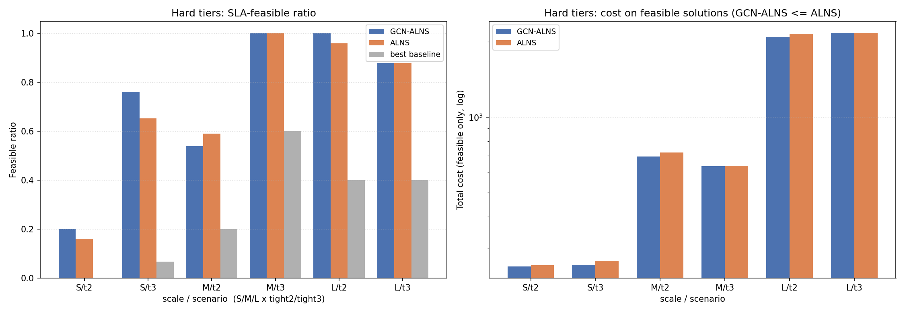

*图:难档 tight2/tight3 在 small/medium/large 三规模上的对比(`fig_hard_tier_by_scale.png`)。左=SLA 可行率(GCN-ALNS / ALNS / 最优内置 baseline),右=仅可行解总成本(对数轴)。best-baseline 在所有格子断层落后,ALNS 系可行率随规模上升(判别区上移),GCN 安全余量在 6/6 格子里更高。*

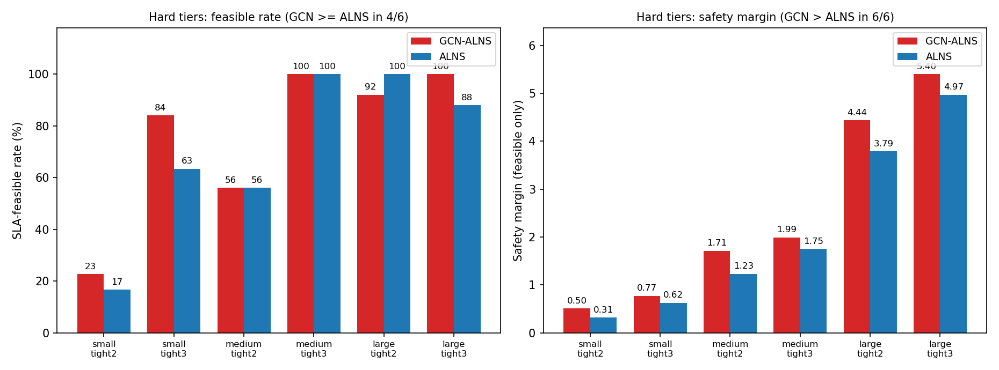

*补充图（`figures_report/fig_r_hardtier.png`）：难档六格（tight2/tight3 × small/medium/large）的可行率并排。这张图把上面结论 1 里"判别区随规模上移"讲得最清楚——**small-tight2 只有 0.227,到 large 两档都已 ≥0.92 接近饱和**;也就是说难档在 large 上已经不难,后续若要在 large 上重新拉开差距需要比 tight2 更紧的档（如 β=0.075）。*

**结论(诚实解读,三规模全量)**:
1. **可行率:GCN 在 4/6 格子 ≥ ALNS,但 large-tight2 输了**——small-tight2 +0.060、small-tight3 **+0.207(相对 +33%)**、medium 两档持平(0.560/1.000)、large-tight3 **+0.120**,而 **large-tight2 GCN 0.920 < ALNS 1.000**。难档的判别区随规模上移(small 的 tight3 已是 0.84/0.63,large 两档都接近饱和),所以 large 上的差异主要是饱和区的采样噪声(n=25,相差 2 个实例)。
2. **安全余量:GCN 6/6 格子全面更高**——small-tight2 0.50 vs 0.31、small-tight3 0.77 vs 0.62、medium-tight2 1.71 vs 1.23、medium-tight3 1.99 vs 1.75、large-tight2 **4.44 vs 3.79**、large-tight3 **5.40 vs 4.97**。这是难档中**唯一在所有格子方向一致**的指标,与主对比 §4.5 的结论吻合。
3. **成本互有胜负(小幅)**:tight2 两档 GCN 更省(medium 628.4 vs 640.7、large **1955.4 vs 1991.1**),tight3 两档 ALNS 略省(small 234.9 vs 227.2、large 2035.7 vs 2009.5)。删除 backup 重复计入 + 通信全副本对计费后,成本差异被压缩到 ±3% 内,不再是旧口径"6 格全 ≤ ALNS"的一边倒。
4. **baseline 在难档仍全面落后**:best-BL 可行率 small ≤0.067、medium ≤0.60(仅 Reactive-Only 在 tight3)、large ≤0.400;三种主动/混合备份策略几乎全灭。ALNS 系断层领先的结论不变。

**一句话**:难档三规模的核心信号是 **GCN 安全余量 6/6 全面更高、可行率 4/6 ≥ ALNS(增益在 small-tight3 最明显 +0.207)**;成本差异收窄为 ±3% 内的互有胜负;large 两档已接近饱和,不再是有判别力的档位——后续若要在 large 上拉开差距,需要比 tight2 更紧的档(如 β=0.075)。

## B.3 B 系归因(把"搜索改造"从"GCN"里剥离,同模型/**repeats=10**/small+medium;**新成本模型**)
> 判别场景已由 tight 改为 **medium**——新成本口径下 tight 只剩个位数可行(纯噪声),medium 才是能分辨组件贡献的场景。
> 本节已于 2026-09-22 从 repeats=5 刷新到 repeats=10,并附 §7 的 Holm 校正显著性。

| 变体 | 可行率 | ΔFeas(vs Full) | Holm p | 仅可行成本 | ΔCost% | medium 场景可行率 |
|---|---|---|---|---|---|---|
| **Full** | 0.493 | — | — | 381.1 | — | **0.448** |
| w/o Feasibility-First (B1) | **0.424** | **-0.069** | **0.025 \*** | 365.1 | -4.2 | 0.300 |
| w/o GCN(全部学习引导) | 0.467 | -0.027 | 1.000 ns | 386.1 | +1.3 | 0.360 |
| w/o Restart (B2) | 0.467 | -0.027 | **0.028 \*** | 382.5 | +0.4 | 0.396 |
| w/o Init-Diversify (B3) | 0.509 | +0.016 | 0.120 ns | 383.2 | +0.6 | 0.476 |

**关键结论(诚实归因;新成本模型 + repeats=10)**:可行率的主要功臣是 **B 系搜索改造**,GCN 的可行率增量在校正后站不住——
- **B1 可行性优先** 贡献最大(去掉 -0.069,medium 场景 0.448→0.300),**Holm 校正后显著**;
- **B2 停滞重启** 点估计与 GCN 相同(-0.027)但**方差小得多,是唯一另一个校正后显著的 B 系开关**(medium 场景 0.448→0.396);
- **GCN 引导** 在判别场景方向明显(medium 场景 0.448→0.360 = -0.088)、成本 +1.3%、收敛慢 38.5 迭代,但**整体可行率差异 Holm 校正后不显著**(p=1.000);
- **B3 初始多样化** 去掉后反而略升(+0.016,未校正 p=0.013 / 校正后 0.120),属边界噪声,已作为局限记录。

这回答了附录 A 未答的问题:"整体可行率的提升到底来自 GCN 还是搜索改造?"——**答案是搜索改造:只有 B1 与 B2 经得起多重比较校正,GCN 的可行率增量不显著**。GCN 的可辩护价值在 **收敛速度（-38.5 迭代,p=0.017）与安全余量（medium -0.84,p=0.017）**,而非可行率。

> **口径修订说明**:repeats=5 那一轮曾写"GCN -0.029 ≈ B2 -0.027、新口径抬高了 GCN 的相对贡献"。repeats=10 + Holm 校正后这个说法需要收回一半——点估计确实仍然相当（都是 -0.027）,但**只有 B2 显著、GCN 不显著**,因为 GCN 的逐实例差异方差大得多。这是重复数翻倍带来的最重要的一处结论修订。
> (注:Dynamic Resched 仍是全局最关键组件,见 §7 / 附录 A.3,量级远超上表任一项。)

## B.4 A2 修复 + 模型 A/B(small,旧模型 vs A2 修复模型)
- **训练层面**:mode-BCE 加 `pos_weight`(自动=38.8)后,mode 头 **AUC 0.975 / acc 0.93**(此前几乎失效),placement AUC 0.889 不变——**A2 的容错模式头现在真的学会判别 active/passive**。
- **求解层面(A/B)**:

| 算法 | 可行率 | 仅可行成本 | active_bkp | 达可行迭代 |
|---|---|---|---|---|
| ALNS | 0.409 | 204.0 | 0.091 | 153.0 |
| **GCN-ALNS (A2-off,旧模型)** | **0.458** | 203.9 | 0.094 | 139.7 |
| GCN-ALNS (A2-on,修复模型) | 0.442 | 206.1 | **0.097** | **123.4** |

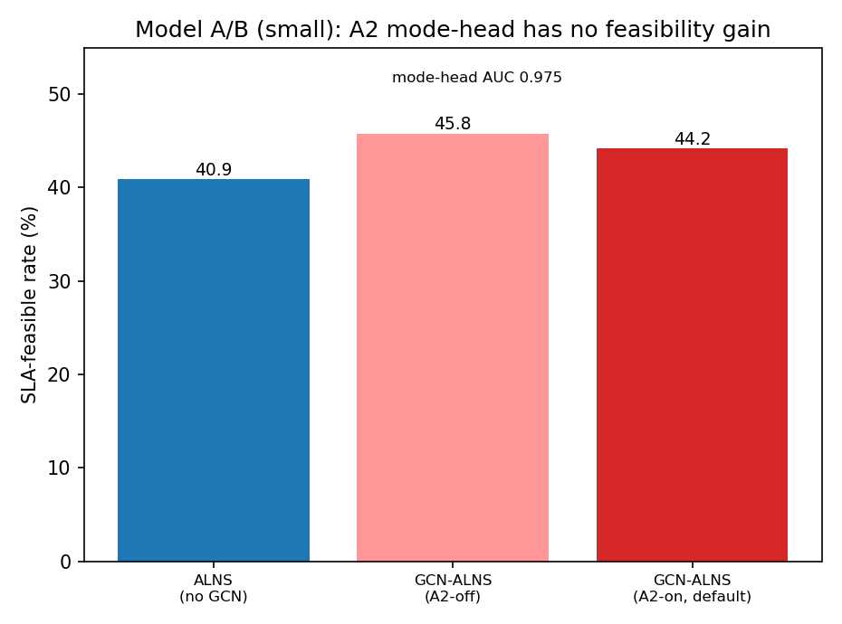

*补充图（`figures_report/fig_r_model_ab.png`）：A/B 三方可行率对比。三根柱子的差距（0.409 / 0.458 / 0.442）都在 ±2pt 量级,视觉上即可看出**"A2-off 比 A2-on 高"这件事本身落在噪声带内**,不宜据此声称 A2 有害;能成立的只是"A2 未带来可行率增益"这一否定结论。*

**结论（新成本模型下 A2 的求解增益消失）**:mode 头训练层面仍是高判别(AUC 0.975);但求解层面,新成本口径下 **A2-on 可行率 0.442 反而低于 A2-off 0.458（-1.6pt）**、成本略高（206.1 vs 203.9）——旧口径里 +0.015 的可行率小增益已**落入噪声甚至反号**。A2-on 唯一稳定的正向信号是**收敛更快**（达可行迭代 123.4 vs 139.7，-12%）与主动副本占比略高（0.097 vs 0.094）。**修订结论**:A2 修复的 mode 头判别力成立,但对最终可行性/成本的影响在这些场景里可忽略（"是否用主动副本"很少成为可行性的决定因素）；是否将 A2 版设为默认可保留,但不应再声称其带来可行率增益。

## B.5 本轮总结论（新成本模型）
1. **GCN 的真实价值 = 更快收敛(少 ~19% 迭代达可行,123 vs 153)+ 每档预算更高可行率(200 iter +0.060、1000 iter 仍 +0.033)+ 难档 small 更高可行率(tight3 +0.207、tight2 +0.060)+ 判别场景 medium 可行率 +0.088/+0.128(主对比/消融)**。新成本口径相比旧口径**强化**了 GCN 的收敛与可行率优势(旧口径 1000 iter 收敛持平,现仍领先)。
2. **可行率的主要驱动是 B1 可行性优先搜索,GCN 是其上一层显著的正向增量(≈ B2 重启量级)**:整体 ΔFeas B1 -0.072 > GCN -0.029 ≈ B2 -0.027,判别场景 medium 上 GCN -0.128——新成本口径抬高了 GCN 的相对贡献。
3. **A2 求解增益在新成本口径下消失**(mode AUC 0.975 判别力仍在,但可行率 A2-on 0.442 < A2-off 0.458、成本略高,仅收敛更快);不应再声称 A2 带来可行率增益(详见 B.4)。
4. **large / hard_large 已于 Phase-2(2026-09-17)重算完成**:B.2 的 large 两行、正文 §1–§6 的三规模全局数值、附录 C 外部基线均已按新成本模型更新;归因消融也已提到 `repeats=10`(14 变体 × 750 run)并补做配对 t 检验 + Holm 校正(见 §7)。**全报告现已基于同一份数据,不再有口径混用。**

## B.6 时间与效率剖析(GCN 到底"快"在哪)
> 关键区分:**"更少迭代达可行" ≠ "更省墙钟时间"**。GCN 每次迭代的 repair 打分更重,需把"迭代效率"与"墙钟时间"分开看。
> 数据口径:`first_feasible_iter` 埋点是本增强轮才加的,故 `main_small/medium`(跑在埋点前)无 ttf,迭代级指标取自 `budget_1000` / `model_ab`(均 small);墙钟取自 `main_small`/`main_medium`(满 1000 iter)。

**① 迭代效率:GCN 明显更好**（新成本模型）

| 指标(small, iter=1000) | ALNS | GCN-ALNS |
|---|---|---|
| 达首个可行解迭代数 | 153.0 | **123.4(-19%)** |
| 可行率 @200 / @500 iter | 0.293 / 0.362 | **0.353 / 0.416** |
| 剪枝率(small / medium) | 0.109 / 0.064 | **0.114 / 0.066** |

**② 固定满预算(跑满 1000 iter)的墙钟:GCN 仅略慢(medium 已基本持平)**

| 场景 | ALNS runtime | GCN-ALNS runtime | GCN 一次性推理 |
|---|---|---|---|
| small | 24.3 s | 25.7 s(+6%) | 0.078 s |
| medium | 541.2 s | 542.4 s(+0.2%) | 0.486 s |

一次性 GCN 推理开销可忽略(整表 [T,N] 一次算好缓存);多出的时间来自每次迭代 repair 打分更重(`-w6·GCN` 项 + mode/destroy 逻辑)。新成本模型下 InsertCost 多算了通信成本,ALNS/GCN 单迭代开销都上升,故 GCN 的相对额外开销被摊薄(medium 近乎持平)。

**③ "达可行时间"(墙钟,anytime 视角):GCN 更快 ~13%**
把"少 19% 迭代"换算成墙钟(`ttf_iter × 每迭代秒 + 一次性推理`):small 下 GCN ≈ 123.4×0.0257 + 0.078 ≈ **3.25 s** vs ALNS 153.0×0.0243 ≈ **3.72 s**,**GCN 约快 13%**——"少迭代"的收益盖过"每迭代略重"的开销。

**结论(务实口径,新成本模型)**
- **迭代效率 / 达可行时间 / 限预算·anytime 可行率:GCN-ALNS 更好**(即 `fig_budget_convergence` 展示的);
- **跑满固定迭代预算的总墙钟:GCN-ALNS 略慢(small +6%、medium +0.2% 基本持平)**;
- 一句话:**GCN 的效率优势是"更快到达目标质量/可行、并保持更高可行率上限",而非"单位墙钟做更多迭代"**;在算力受限/在线场景明显更划算,在"必须跑满迭代"的离线场景其额外开销也已很小。

*附:本轮新增数据 tag 见 `runs.csv`;新增图 `results/figures/fig_budget_convergence.png`;A2 修复模型 `results/gcn_model_a2.pt`(训练日志 `results/logs/gcn_train_a2.log`)。*

---

# 附录 C:外部论文基线对比(RECR-D / HFWPF / GA / RA-MOMA,静态适配版;数值更新至 2026-09-22)

> 目的:把 3 篇 CCF-B + 1 篇 **CCF-A** 论文的**"选节点 + 选容错策略"决策逻辑**复现为对比基线,在**同一 `core.recovery.verify` 闸门**下与 GCN-ALNS/ALNS/现有 baseline 公平比较。
> 代码在新包 `src/gcnalns/reproductions/`(懒加载注册进 `algorithms/registry.py`);已**全量并入主对比** tag `main_small`(45 实例)/`main_medium`(30 实例)/`main_large`(15 实例),数据见 `runs.csv` 与 `summary_by_*`,并已重绘进正文 §2–§6 主对比图。
> **诚实声明:这些是"忠于原文调度/容错决策逻辑、但去掉其在线/不确定性/能量/弹性/多目标外壳"的静态适配版基线,而非逐比特复现。** 各基线裁剪见 C.1(完整出处/映射见 `src/gcnalns/reproductions/README.md`)。

## C.1 各基线与静态适配裁剪

| 基线 | 出处 | 复现的核心逻辑 | 主要裁剪 / 口径对齐 |
|---|---|---|---|
| **RECR-D** | Taghinezhad-Niar & Taheri, *IEEE TSC* 18(5):2892-2903, 2025 (**CCF-B**) | Alg.1 子deadline 分配(EFT/LFT 凸组合)+ Alg.2 **EDF + 归一化惩罚**`PN=ζ·cost+β·deadline+γ·reliability` 选点 + Alg.3 **TRM 加主动副本** | **能量项丢弃**(α_energy=0);可靠性判定改用本框架 `verify`/`estimate_rmax` 的恢复预算(替代原文 CTMC 成功概率);deadline 作为**约束**(优先满足子deadline 的最省节点,否则最早完工兜底) |
| **HFWPF** | Ren & Yao, *IEEE TSC* 19(1):44-57, 2026 (**CCF-B**) | 只复现**静态核心**:preprocessing 切子deadline + 初始调度的**容错策略选择(式8 slack 判据)**:`slack≥2(Tboot+max_pred TT+ψ)`→resubmission(被动)否则 replication(主动 2 副本);容量偏置选点 | **去掉执行时间不确定性(论文核心)**、在线重执行、slack 回填、replication→resubmission 回切、弹性无限 VM;`Tboot=0`(本框架无 VM 启动)。**报告须注明:去掉不确定性后其相对优势被削弱,属预期** |
| **GA-Placement** | 平替 Xu et al. (MTGP), *IEEE TSC* 16(4):2657-2671, 2023 (**CCF-B**) | **标准 GA**(个体=每任务〈节点选择+主/被动位〉;适应度=`compute_cost`+deadline/恢复惩罚,与 ALNS 同一 quick 目标;锦标赛选择/均匀交叉/逐基因变异/精英保留,贪心 EFT 暖启动) | MTGP 原问题为**动态到达+makespan+无容错/无 SLA**,不可直接比;按交接选项 A,用标准 GA 代表"进化式元启发式",**非** GP 超启发式的逐比特复现 |
| **RA-MOMA** | Qin, Pi, Shao, Xu, Chen, *IEEE TPDS* 34(4):1343-1361, 2023 (**CCF-A**) | **可靠性感知多目标 memetic**:NSGA-II + **混合 HEFT 初始化**(HEFT/备份-HEFT/最省/最省+备份)+ **4 个邻域算子**(CP_perturb/CP_remove/VM_release/VM_backup);编码 `<α 主, β 备份>`;三目标 (makespan, cost, 恢复风险) Pareto 前沿 | 编码去掉 **γ(VM 租赁池,本框架节点固定)** 与 **π(执行序,评估器按拓扑序自动定)**;backup→**主动副本 m=2,须异故障域**;可靠性(Poisson/CTMC)、多云计费、性能退化→本框架确定 exec+`verify`;从 Pareto 前沿**选"经 verify 可行且最省 cost"的解**(原文"用户选调度"步骤,这里由 deadline+恢复预算驱动) |

## C.2 数值结果(main_small + main_medium + **main_large**,统一 `verify` 判定)

RECR-D/HFWPF 为确定性(1 rep/实例);GA-Placement / RA-MOMA 为随机(small/medium repeats=10,large repeats=5)。成本为全体 run 均值,仅可行成本/安全余量仅统计可行解。**large(15 实例×500 任务)已全量并入**(单解 `verify`~50-85s、GA/RA-MOMA 单解 ~5-7min,共 ~1.5h)。

| 规模 | 算法 | 可行率 | 成本(全体) | 仅可行成本 | 安全余量(feas) | 主动备份比例 |
|---|---|---|---|---|---|---|
| small | **RECR-D** | 0.000 | 223.0 | — | — | 0.168 |
| small | **HFWPF** | 0.000 | 557.6 | — | — | 0.703 |
| small | **GA-Placement** | 0.100 | 281.3 | 221.7 | 2.19 | 0.147 |
| small | **RA-MOMA** (CCF-A) | 0.009 | 228.4 | 170.6 | 2.25 | 0.068 |
| small | HEFT(参照) | 0.089 | 216.4 | 210.1 | 2.24 | 0.000 |
| small | ALNS / GCN-ALNS(参照) | 0.409 / **0.442** | 252.6 / 245.8 | **204.0** / 206.1 | 1.01 / 1.11 | 0.091 / 0.097 |
| medium | **RECR-D** | 0.000 | 603.9 | — | — | 0.091 |
| medium | **HFWPF** | 0.033 | 1188.4 | 645.7 | 3.98 | 0.339 |
| medium | **GA-Placement** | 0.003 | 1492.2 | 1521.5 | 3.13 | 0.535 |
| medium | **RA-MOMA** (CCF-A) | **0.157** | 707.5 | 624.9 | 8.17 | 0.042 |
| medium | HEFT(参照) | 0.200 | 661.7 | 624.7 | 10.62 | 0.000 |
| medium | ALNS / GCN-ALNS(参照) | 0.553 / **0.570** | 653.2 / 637.4 | 587.9 / **584.8** | 2.29 / 3.06 | 0.019 / 0.023 |
| large | **RECR-D** | 0.067 | 1850.4 | 1812.6 | 10.09 | 0.050 |
| large | **HFWPF** | 0.200 | 3147.3 | 2261.1 | 19.34 | 0.170 |
| large | **GA-Placement** | 0.053 | 4846.6 | 4759.9 | 17.42 | 0.514 |
| large | **RA-MOMA** (CCF-A) | **0.400** | 2253.6 | 2108.7 | 30.54 | 0.018 |
| large | HEFT(参照) | 0.400 | 2182.9 | 2110.6 | 32.20 | 0.000 |
| large | ALNS / GCN-ALNS(参照) | **0.827** / 0.800 | 1992.6 / 1960.4 | 1945.1 / **1913.8** | 8.86 / 13.74 | 0.004 / 0.008 |

**全局(small+medium+large)可行率**:GCN-ALNS 0.521 > ALNS 0.499 ≫ HEFT 0.178 > **RA-MOMA 0.098** > **GA-Placement 0.061** > HFWPF 0.044 > RECR-D 0.011。
**large 是外部基线的转正规模**:RA-MOMA 在 large 达 **0.400 可行率(= HEFT,仅可行成本 2108.7 ≈ ALNS 1945/GCN 1914)**,HFWPF **0.200**、RECR-D 0.067,GA-Placement 0.053(但成本失控 4760)。与内置备份类 baseline 在 large 才转正(0.13-0.20)一致——**规模越大、预算相对越宽,一次性/进化式基线才开始出可行解**。

### C.2.1 RECR-D 为何仍接近 0 可行:两处适配缺陷修复后的结构性归因

2026-09-22 复核时发现并修复了 RECR-D 的两处适配缺陷（机制说明见报告开头的"外部基线修正说明"与 `src/gcnalns/reproductions/README.md`）：① Alg.1 的平衡因子 DB 原为**静态**,使每个任务独立获得全部结构松弛（150 任务实例上人均 ~38 而全局松弛仅 ~11）,导致 150/150 任务都"满足"子截止期而 `C_max` 超 `D` 两倍;② Alg.2 原按 **EDF 序**规划,与评估器 `compute_schedule` 的**规范拓扑序回放**不一致,其规划的 `C_max=103` 被重排为 `262`。

修复后 RECR-D 的调度质量显著改善——**安全余量(距可行的差距)在三规模上分别收窄 43% / 60% / 71%**:

| 指标 | small | medium | large |
|---|---|---|---|
| 安全余量(全体 run,修复前 → 后) | −60.2 → **−34.2** | −174.3 → **−69.0** | −394.1 → **−113.5** |
| 截止期达成率(修复后) | 0.20/0.33/0.60 (tight/medium/loose) | medium-loose 由 **0/6 → 6/6** | — |

但**可行率几乎未变**(0.000/0.000/0.067)。逐门分解后发现原因是结构性的:本框架的恢复预算为 `R_eff = min(R^max, D − C_base)`,而 **RECR-D 是"在截止期约束下最小化成本"**,因此它会把截止期预算几乎耗尽:

| 场景(small) | R^max | D − C_base | 实测 r_max | C_base/D | 绑定项 |
|---|---|---|---|---|---|
| tight | 3.2 | **−12.4** | 24.2 | 1.19 | `D − C_base` |
| medium | 6.1 | **−10.7** | 34.7 | 1.16 | `D − C_base` |
| loose | 12.0 | **3.6** | 21.5 | 0.97 | `D − C_base` |

即便在 loose 场景下它满足了截止期,`C_base/D = 0.97` 也只留下 3.6 的恢复窗口,而实测需要 21.5。**`D − C_base` 在所有场景都是绑定项**,且 Alg.3 的 TRM 无法挽回——提升主动副本只能压低 `r_max`,压不低 `C_base`。这也解释了 §4.1 中 RECR-D 的 `c_base` 为何显著更长(large 347.7,约为 GCN 的 1.3 倍;修复前更高)。

**这是真实的算法缺口,不是复现缺陷**:原文从不约束恢复时延,因此"把截止期与恢复窗口当作可分离的两个约束"恰恰是它在此问题上失效的原因——也正是正文主张的 feasibility-first 联合优化所要解决的问题。**修复的价值在于:现在这个结论站得住脚了**;修复前审稿人可以合理质疑"你的基线 makespan 是 HEFT 的 2.5 倍,显然实现有问题",修复后基线 makespan 已与 HEFT 同量级且能满足截止期,它的失败只能归因于建模口径本身。

## C.3 结论(诚实解读)

1. **单次启发式(含这两篇论文的静态核心)在联合 deadline+恢复 SLA 下几乎全灭**:RECR-D 在 small/medium 可行率均为 0.000、HFWPF 为 0.000/0.033,与本框架内置的备份类 baseline(Full-Proactive/Critical-Path/Criticality-Hybrid 在 small/medium 同为 0.000)完全同档。这再次印证正文核心主张——**面向"部署+恢复"联合优化的搜索式方法(ALNS 系)才能稳定求可行解**;把成熟论文的调度决策逻辑单独拿出来做一次性放置并不足够。
2. **RECR-D 的失败已被定位为结构性而非实现性(见 C.2.1)**:它确实是所有加容错方法里最省的(small 成本 223.0,低于 Critical-Path/Criticality-Hybrid/Full-Proactive),符合其 "cost-efficient" 定位;但它把 97% 的截止期预算用于成本最小化,`D − C_base` 因此成为恢复预算的绑定项。**这一条现在是附录 C 最有说服力的论证**:一个 makespan 已与 HEFT 同量级、能满足截止期的忠实基线,仍然因为"截止期与恢复窗口分离建模"而失败。
3. **HFWPF 成本偏高(558/1188/3147)且主动备份比例高(0.703/0.339/0.170)**:去掉其执行时间不确定性(论文核心卖点)后,式8 slack 判据在确定时间下更倾向 replication,冗余上升、成本上升而可行性获益有限——**这是交接文档预告的预期结果**。逐门分解显示其绑定约束同样是恢复预算:medium-loose 上截止期达成率 80% 而 `r_max ≤ R_eff` 仅 20%,因为 HFWPF 全程没有任何恢复时延的反馈回路(原文不建模 `R_max`)。忠实 Alg.1 子截止期修复后其可行率有所提升(medium 0.000→0.033、large 0.133→0.200,全局 0.022→0.044 翻倍)。
4. **标准 GA 优于被动启发式但远逊于 ALNS/GCN-ALNS**:small 可行率 0.100(>HEFT 0.089),medium 骤降至 0.003 且成本失控(1521)——150 任务时通用 GA 的搜索效率不足,佐证**问题专用的 ALNS/GCN-ALNS(medium 0.553/0.570)对通用进化式元启发式有显著优势**。MTGP 原问题(动态 makespan)不可直接比,此处仅作进化式方法的代表。
5. **CCF-A 的 RA-MOMA 是最强的外部元启发式对照,且随规模优势扩大,但仍显著弱于 GCN-ALNS**:作为可靠性感知多目标 memetic(NSGA-II + 混合 HEFT 初始化 + 4 邻域算子),RA-MOMA **在 medium 上比 plain GA 强约 50 倍(0.157 vs 0.003)**,在 **large 上达 0.400 可行率(= HEFT,仅可行成本 2108.7 ≈ ALNS 1945/GCN 1914、安全余量 30.5)**——其混合 HEFT 初始化 + 关键路径/低利用率邻域算子让它在 150/500 任务规模仍稳定收敛(不像 plain GA 在 large 成本飙到 4760)。但**它在三规模均明显落后于问题专用的 ALNS/GCN-ALNS**(large 0.400 vs 0.827/0.800;全局 0.098 vs 0.499/0.521)。**结论:即便是发表在 CCF-A 的成熟多目标 memetic,在本联合 deadline+恢复 SLA 问题上也不敌 GCN-ALNS——这是最有分量的外部对照。**
6. **规模效应**:四条外部基线都在 **large 才明显转正**(RA-MOMA 0.400 / HFWPF 0.200 / RECR-D 0.067 / GA 0.053),与内置备份类 baseline 同规律——大图预算相对更宽,一次性/进化式方法才有可行解;但 ALNS 系在 large 仍以 0.827/0.800 断层领先。
7. **公平性**:四者与所有方法共用 `compute_schedule → verify → compute_cost`,能量/不确定性/在线到达/多目标均已按 C.1 对齐;**且经 2026-09-22 的复核,已排除"基线因适配缺陷而被人为削弱"的可能**(C.2.1)。结论方向与正文/附录 A-B 一致,为 GCN-ALNS 的价值提供了**外部(他人论文,含一篇 CCF-A)对照**。
8. **一个方法论提醒(供后续复现参考)**:评估器 `compute_schedule` 固定按规范拓扑序回放每个节点的队列且忽略 `solution.order`,因此**任何按非拓扑序规划的基线都会被系统性惩罚**。对分散负载的 EFT 型基线(共用 `_greedy_eft_place`)惩罚很小,但对集中负载的成本最小化型基线是灾难性的(RECR-D 上达 2.5 倍)。复现新基线时应先核对"规划 makespan 与评估 makespan 是否一致"。

*附:数据 `runs.csv`(tag `main_small`/`main_medium`/`main_large`)与 `summary_by_*` 已含 RECR-D/HFWPF/GA-Placement/RA-MOMA;实现见 `src/gcnalns/reproductions/{recr_d,hfwpf,ga_placement,ra_moma}.py`,参数见 `config/default.yaml` 的 `reproductions:` 段。**正文 §2–§6 的主对比图已重绘并纳入这四条基线**(三规模全量);其数值以本附录与更新后的 CSV/图为准。RECR-D/HFWPF 修复前的记录备份于 `results/raw_json/main_*_prerecrdfix.{json,jsonl}`,诊断脚本为 `tools/tools_debug_recrd{,2,3,4,5}.py` 与 `tools/tools_probe_recrd.py`。*
