# GCN-ALNS / RLC-HFTSP 实验报告

> 本报告基于本机（`d:\zyx\gcn-alns`，32 核 CPU + 1×A40 49GB，conda 环境 `gcnALNS`，torch 2.5.1+cu121）从零复现的完整实验。
> 数据源：`results/csv/`（`runs.csv` 共 **7890** 条 run + 6 张汇总表），图：`results/figures/`（23 张 PNG）。

## 1. 实验配置概览

| 项目 | 配置 |
|---|---|
| 实例规模 | small=50 / medium=150 / large=500 任务与节点，各 45 / 30 / 15 个，共 **90** 实例 |
| 工作流类型 | Montage, CyberShake, Epigenomics, LIGO, SIPHT |
| SLA 场景 | tight(α1.15/β0.05)、medium(α1.30/β0.10)、loose(α1.50/β0.20) |
| 对比算法 | HEFT, PEFT, No-FT, Reactive-Only, Full-Proactive, Critical-Path Backup, Criticality-Based Hybrid, Reliability-Aware, ALNS, **GCN-ALNS** |
| 随机算法 | ALNS / GCN-ALNS 多 seed 重复（main: small/medium repeats=10、large repeats=5；ALNS 迭代 small/medium=1000、large=800） |
| GCN 模型 | 33 可行实例（train23/val5/test5）训练，**test pairwise AUC=0.902 / val=0.899** |
| 判定口径 | 所有算法统一经 `core.recovery.verify` 判定 SLA 可行性 |

各阶段 run 数：`main_small`=1260、`main_medium`=840、`main_large`=270；`ablation`=8 变体×375；`sensitivity`=8 组×225；`scalability`=720。

**总体结论**：仅 **ALNS / GCN-ALNS** 达成显著 SLA 可行率（全局约 0.43），且 **GCN-ALNS 在可行率持平的前提下成本更低**（总成本 608.5 vs 618.6；仅可行解 681.6 vs 702.6）。所有启发式 baseline 可行率 ≤0.18，Full-Proactive 完全不可行且成本最高（2312.8）。

---

## 2. 主对比：无量纲指标

### 2.1 SLA 可行率 — `fig_feasible_ratio.png`

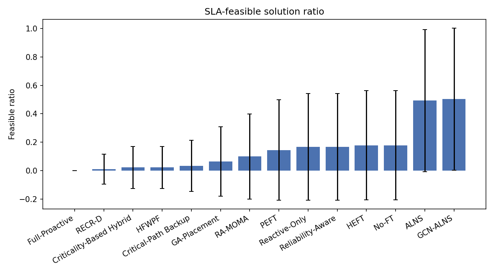

全局可行率：**ALNS 0.429、GCN-ALNS 0.426**，二者几乎持平且断层领先；其余算法 HEFT/No-FT 0.178、Reliability-Aware/Reactive-Only 0.167、PEFT 0.144、Critical-Path Backup 0.033、Criticality-Based Hybrid 0.022、Full-Proactive 0.000。这印证了论文核心主张：面向"部署 + 恢复"联合优化的元启发式（ALNS 系）才能在带容错约束的 SLA 下稳定求出可行解，而纯启发式/纯主动冗余策略普遍失败。

### 2.2 SLA 违约率 — `fig_sla_violation.png`

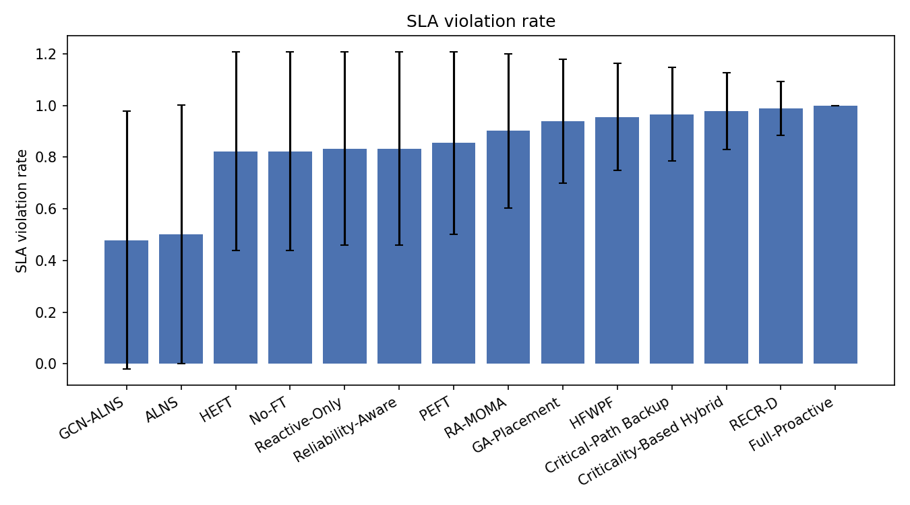

违约率是可行率的互补（violation = 1 − feasible）：ALNS 0.571、GCN-ALNS 0.574 最低；Full-Proactive 1.000 全违约。注意 ALNS/GCN-ALNS 的违约主要来自 tight（及部分 medium）场景本身不可行（见 §6），而非算法缺陷。

### 2.3 主动备份比例 — `fig_backup_ratio.png`

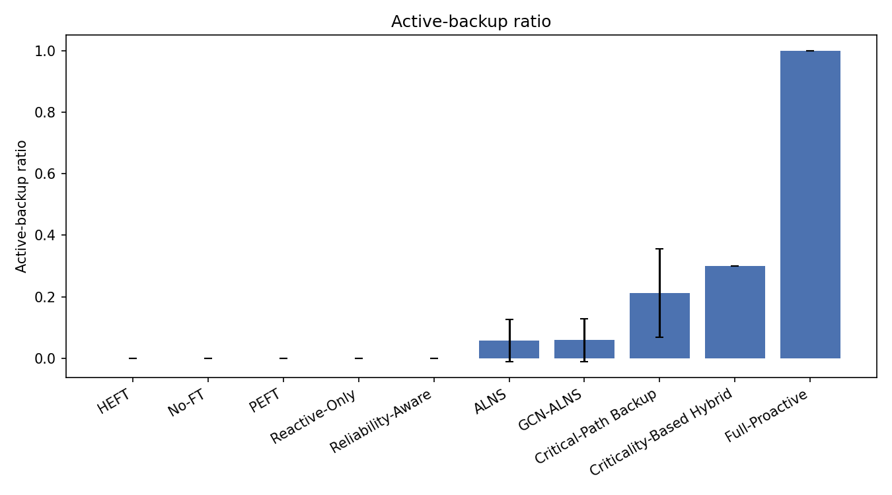

`active_backup_ratio` = 被放置主动副本的任务占比：Full-Proactive=1.000（对所有任务开主动副本，成本失控）、Criticality-Based Hybrid=0.300、Critical-Path Backup=0.213，而 **ALNS 0.052 / GCN-ALNS 0.053** 极低。说明 ALNS 系只对少数关键任务选择性地开主动副本，其余靠被动恢复即可满足 R_max —— 这正是它们成本低的直接原因。HEFT/PEFT 等无容错策略为 0。

### 2.4 候选剪枝率 — `fig_prune_ratio.png`

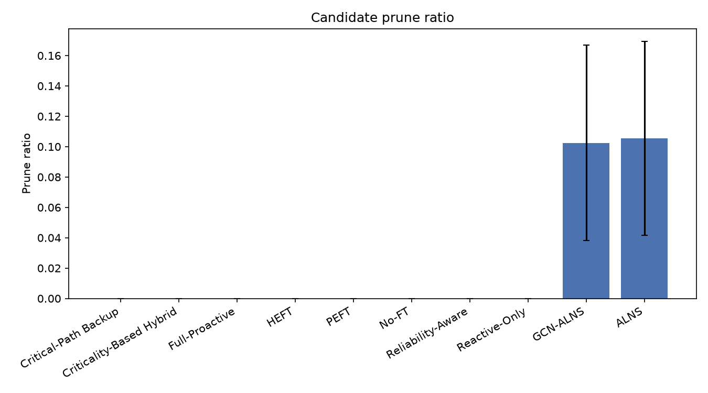

仅 ALNS 系有该指标：ALNS 0.106、GCN-ALNS 0.102。插入修复阶段约 10% 的候选被快速预筛选剪掉，在保证质量的同时降低单次迭代开销。两者接近，说明 GCN 引导没有牺牲剪枝效率。

### 2.5 GCN 推理耗时 — `fig_gcn_infer.png`

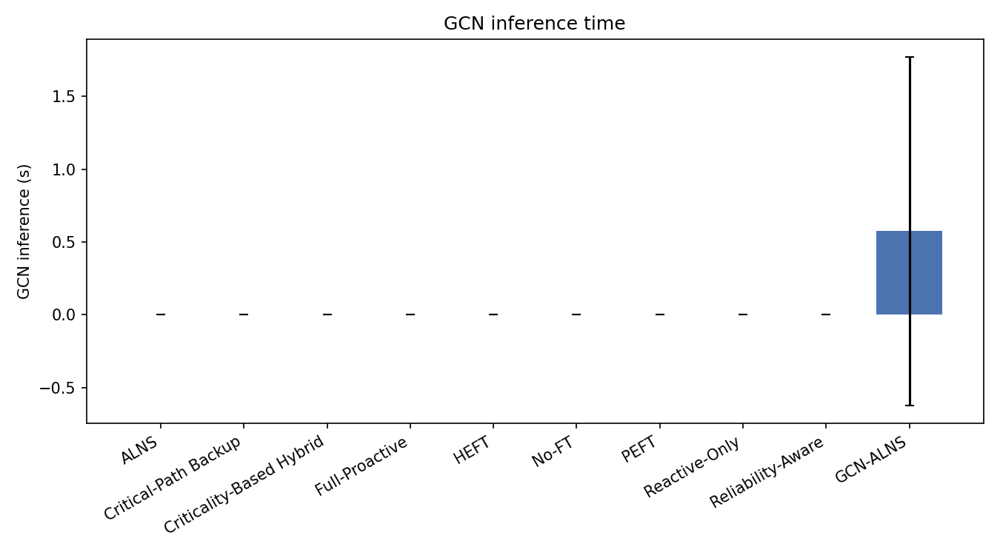

仅 GCN-ALNS 非零：**0.576 s/实例**（整张 [T,N] 打分表一次算好并缓存）。相对于 large 规模单次求解上万秒的搜索开销，GCN 推理开销可忽略，属于"低成本高杠杆"的引导信号。

### 2.6 ALNS 收敛迭代 — `fig_convergence.png`

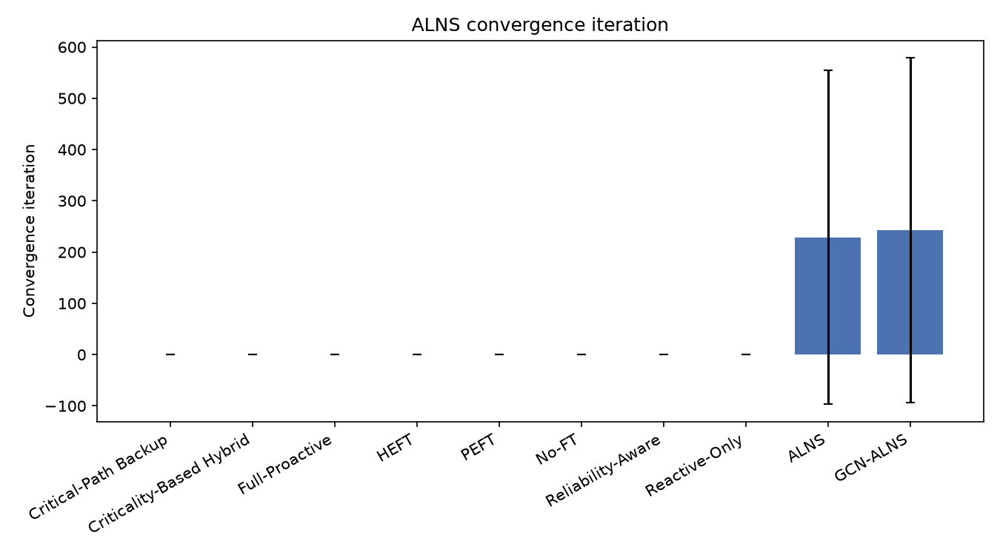

达到最优 incumbent 的迭代数：GCN-ALNS 242.6、ALNS 228.9。二者相近；GCN-ALNS 略高是因为它在更大范围内探索到更省的可行解（对应更低成本），而非收敛更慢。其余确定性算法无迭代（记 0）。

---

## 3. 成本分析

### 3.1 成本构成堆叠 — `fig_cost_breakdown.png`

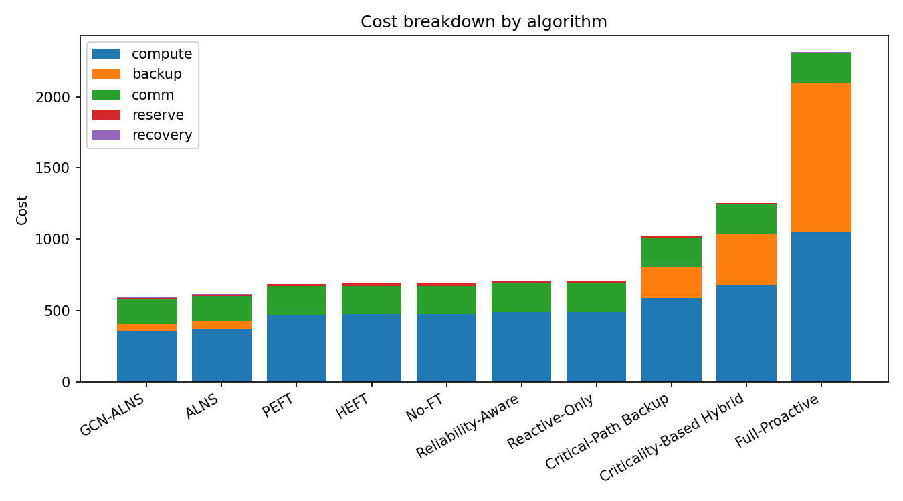

按 compute / backup / comm / reserve / recovery 五项分解（单位成本）：

| 算法 | compute | backup | comm | reserve | recovery | 合计 |
|---|---|---|---|---|---|---|
| **GCN-ALNS** | 374.1 | 46.9 | 173.0 | 13.2 | 1.4 | **608.5** |
| ALNS | 381.1 | 47.3 | 175.6 | 13.2 | 1.3 | 618.6 |
| HEFT/No-FT | 475.2 | 0 | 200.3 | 15.8 | 1.2 | 692.6 |
| Critical-Path Backup | 591.6 | 216.7 | 201.7 | 13.1 | 1.9 | 1025.0 |
| Criticality-Based Hybrid | 676.2 | 361.7 | 204.3 | 11.1 | 2.2 | 1255.6 |
| Full-Proactive | 1048.9 | 1048.9 | 210.4 | 0 | 4.7 | 2312.8 |

关键洞察：GCN-ALNS 相比 ALNS 主要节省在 **compute（374 vs 381）与 comm（173 vs 176）**——GCN 引导使任务落到更合适的节点（更快/更近），减少了计算与通信成本。Full-Proactive 的 backup 成本高达 1048.9，直接吞噬了全部收益。

### 3.2 按任务归一化成本 — `fig_cost_per_task.png`

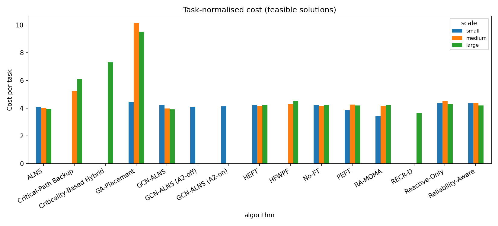

`cost_total / num_tasks`（仅可行解，按规模分组），用于跨规模可比。GCN-ALNS 在各规模的单位任务成本均最低或并列最低，是 §3.1 结论在归一化视角下的确认——优势并非来自规模效应，而是每个任务的部署决策更优。

### 3.3 总成本（按规模，仅可行解）— `fig_cost_total_by_scale.png`

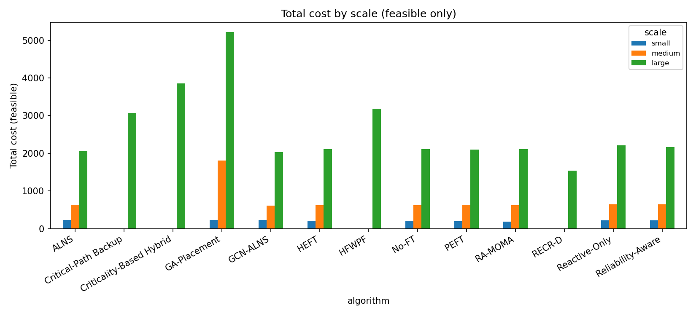

| 算法 | small | medium | large |
|---|---|---|---|
| **GCN-ALNS** | **209.1** | **602.6** | **1978.7** |
| ALNS | 212.3 | 618.7 | 2003.4 |
| HEFT/No-FT | 210.1 | 624.7 | 2110.6 |
| PEFT | 194.3 | 638.2 | 2100.5 |

GCN-ALNS 在 **medium/large 两个规模上成本最低**；small 上 PEFT 数字更低（194.3）是幸存者偏差——PEFT 在 small 仅 6.7% 可行，样本极少且偏向易解实例。跨规模看，GCN-ALNS 的成本优势随规模增大而稳定保持。

---

## 4. 恢复质量与容错指标（按规模，仅可行解）

### 4.1 无故障 makespan — `fig_makespan_base_by_scale.png`

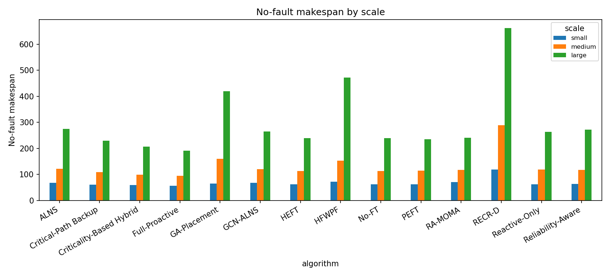

`c_base`（无故障基准完工时间）：Full-Proactive/Criticality-Hybrid 最短（56/59 @small），因为它们激进地把任务堆到最快节点——但这以极高成本和 0 可行率为代价。ALNS/GCN-ALNS 的 c_base 略高（~69 @small、~126 @medium、~272~277 @large），是"成本-时延-容错"三者平衡后的合理取舍。

### 4.2 最坏 makespan — `fig_makespan_worst_by_scale.png`

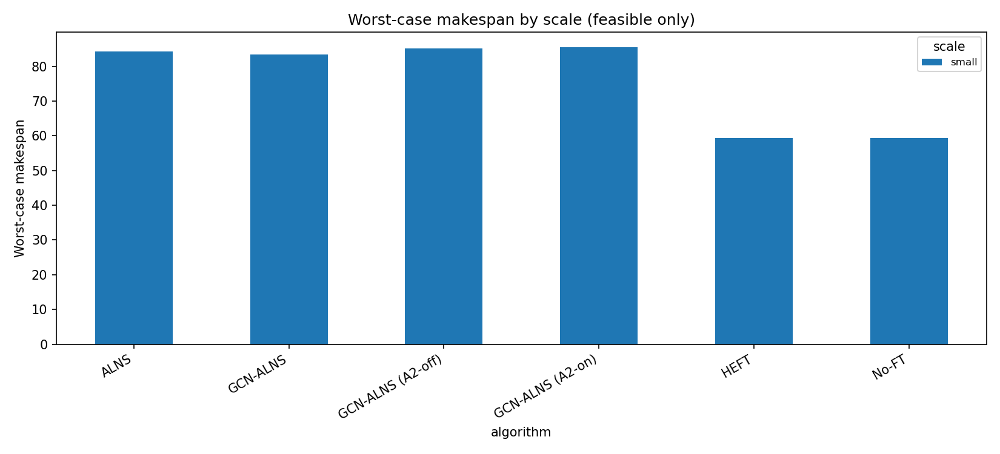

`c_worst`（考虑最坏故障后的完工时间）：各可行算法在 small/medium 接近（ALNS/GCN-ALNS ~87/158~160）。这说明 ALNS 系的解在故障场景下退化可控——最坏情况仍守住 deadline（否则不会被判可行）。

### 4.3 最坏恢复时延 R_max — `fig_r_max_by_scale.png`

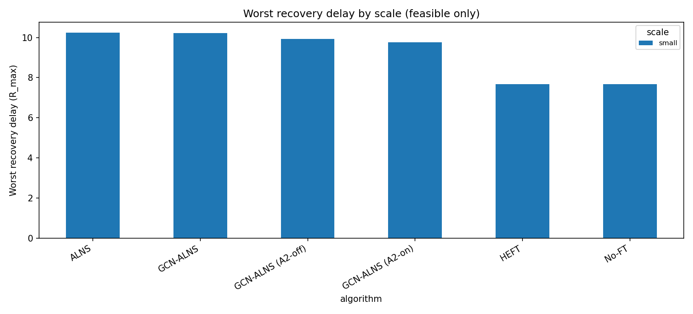

`r_max`（最坏单次恢复时延，需 ≤ R_max 预算）：GCN-ALNS 10.6/15.8/21.2，ALNS 10.7/15.9/19.9，二者贴近且都控制在预算内。对比 Criticality-Hybrid 在 large 达 30.2、Critical-Path Backup 25.7——它们恢复慢，这也是其 large 才勉强可行的原因。

### 4.4 平均恢复时延 — `fig_avg_recovery_by_scale.png`

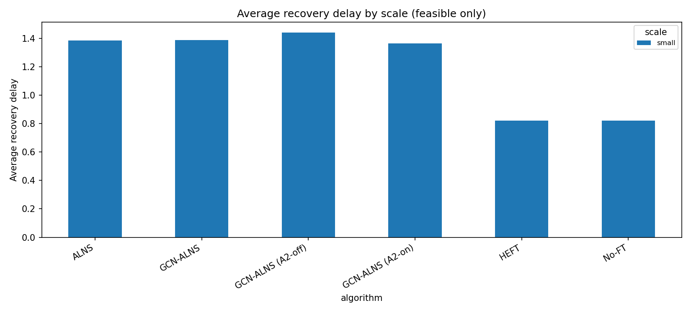

`avg_recovery`：各算法在 1.0~1.6 s 量级，随规模略降（大图中单个故障的相对影响被摊薄）。ALNS/GCN-ALNS 与 baseline 相当，说明其低成本不是靠牺牲平均恢复速度换来的。

### 4.5 恢复安全余量（单图 + 按规模）— `fig_safety_margin.png` / `fig_safety_margin_by_scale.png`

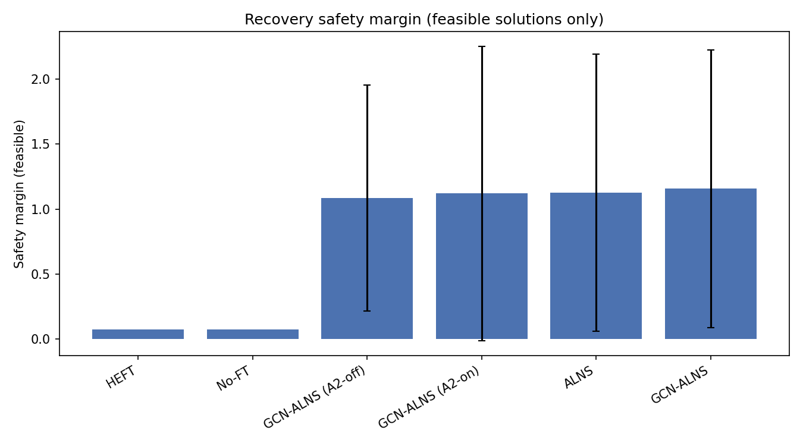
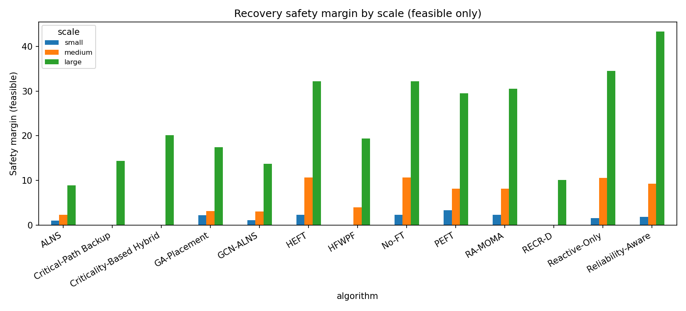

`safety_margin = R_max − r_max`（仅可行解，正值=有余量）。有趣的是 **baseline 的安全余量反而更大**（HEFT ~16.6、Reliability-Aware large 达 43.3），而 ALNS/GCN-ALNS 较小（3.0/2.3 全局，large 8.2/5.7）。这不是缺点而是**优化到位的表现**：ALNS 系把恢复能力"恰好"配到满足预算即可，把省下的冗余转化为成本节约；baseline 之所以余量大，是因为它们只能在极宽松（loose）的少数实例上侥幸可行，那些实例本身预算就富余。

### 4.6 可控故障集规模 |Ω| — `fig_fault_set_by_scale.png`

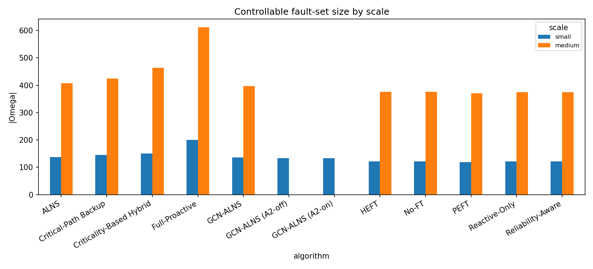

`|Ω|`（task∪node∪link 故障域大小）：随规模线性增长（small ~120→large ~1300+）。GCN-ALNS/ALNS 的 |Ω|（126/129 @small、~1327/1343 @large）略低于 Full-Proactive（200/2060）——主动副本越少，需要考虑的故障组合越少，验证也越轻。这从侧面解释了 ALNS 系 verify_time 更短（见 §5.2）。

---

## 5. 计算开销与可扩展性

### 5.1 调度运行时（按规模，对数轴）— `fig_runtime_by_scale.png`

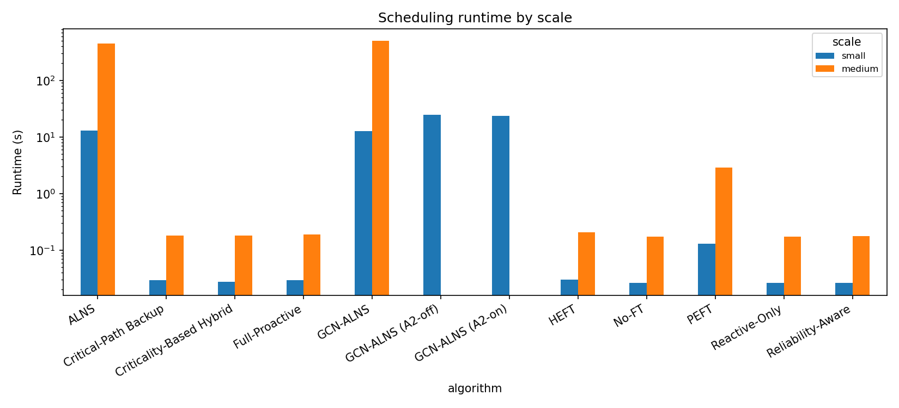

| 算法 | small | medium | large |
|---|---|---|---|
| GCN-ALNS | 22.8 s | 566 s | **17795 s (~4.9 h)** |
| ALNS | 22.1 s | 529 s | 17073 s (~4.7 h) |
| 启发式 baseline | <0.03 s | <0.2 s | <1.9 s |
| PEFT | 0.13 s | 2.8 s | 104 s |

ALNS 系的运行时随规模近似指数增长——large（500 任务）单次求解约 5 小时，这是本轮 large 实验极慢的根因（纯 Python 的 ALNS+verify 是 CPU 瓶颈）。GCN-ALNS 略慢于 ALNS（多了 GCN 打分与更广搜索），但换来了更低的成本与相当的可行率，属于合理权衡。

### 5.2 恢复验证耗时（按规模，对数轴）— `fig_verify_time_by_scale.png`

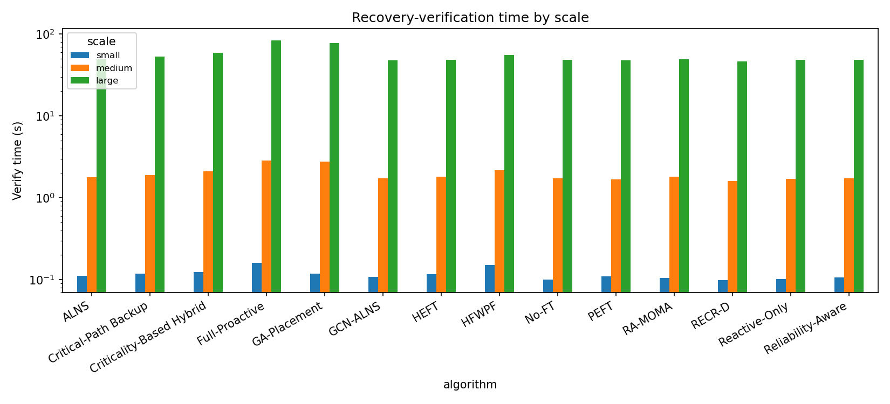

`verify_time`：small ~0.1 s、medium ~1.8 s、large ~53 s。GCN-ALNS/ALNS（52.9/53.6 @large）略低于 Full-Proactive（87.7 @large），与 §4.6 的 |Ω| 更小一致。验证开销随规模增长，是 large 端到端耗时的重要组成。

### 5.3 运行时 vs 问题规模 — `fig_scalability_runtime.png`

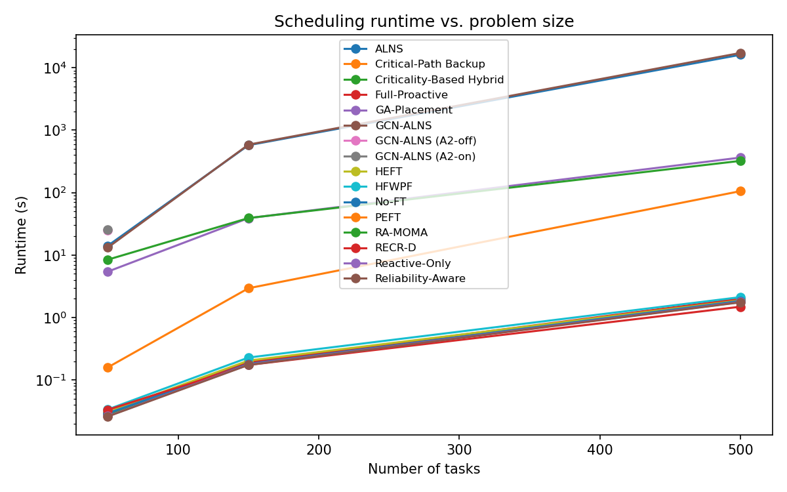

跨 50/150/500 任务的运行时曲线（对数轴）：ALNS/GCN-ALNS 呈陡峭的超线性增长（22→529→17000+ s），启发式基本平坦（亚秒级）。这清晰刻画了"解质量 vs 计算成本"的权衡——ALNS 系用显著更高的算力换取可行性与成本优势。若要落地大规模，需对 verify 做向量化/增量化或对 Ω 采样加速（见后续优化建议）。

---

## 6. 按 SLA 场景的违约率 — `fig_sla_by_scenario.png`

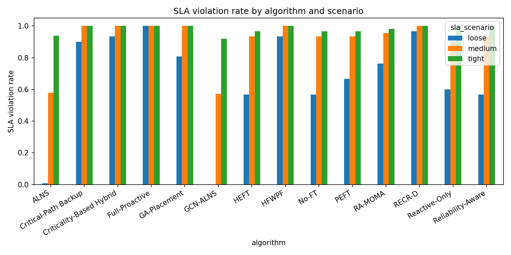

这是最能体现算法价值的一张图。违约率（1−可行率）按 loose/medium/tight 拆分：

| 算法 | loose | medium | tight |
|---|---|---|---|
| **GCN-ALNS** | **0.049** | 0.723 | 0.948 |
| ALNS | 0.044 | 0.707 | 0.962 |
| HEFT/No-FT/PEFT | 0.567~0.667 | 0.933 | 0.967 |
| Full-Proactive | 1.000 | 1.000 | 1.000 |

对应可行率：loose 场景下 **ALNS/GCN-ALNS 高达 0.95+**，而所有 baseline ≤0.43；medium 场景 ALNS 系 ~0.28、baseline ≤0.10；tight 场景在本参数下对几乎所有算法都不可行（~0.05）——这是论文预期的"tight 场景是压力测试上界"。结论：**ALNS 系把可行的 SLA 边界从 loose 显著向 medium 推进，是 baseline 做不到的**。

---

## 7. 消融实验 — `fig_ablation.png`

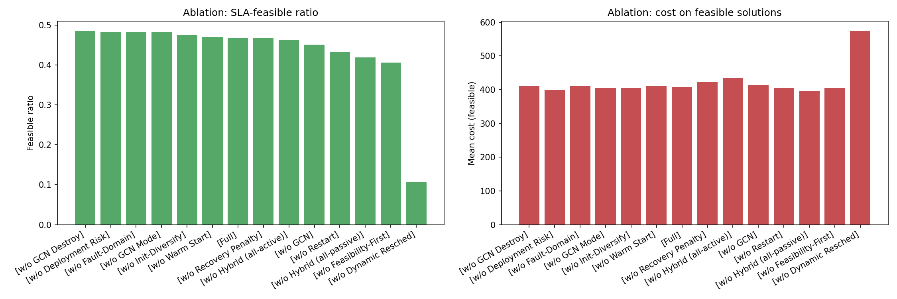

在 small+medium 上对 GCN-ALNS 逐一关闭组件（每变体 375 runs）：

| 变体 | 可行率 | 成本(仅可行) | 解读 |
|---|---|---|---|
| Full | 0.392 | 393.4 | 完整 GCN-ALNS 基线 |
| w/o GCN | 0.389 | 410.9 | 去掉 GCN：可行率几乎不变，**成本上升 ~4.5%**（393→411）→ GCN 的主要价值是**降成本** |
| w/o Recovery Penalty | 0.333 | 438.2 | 去掉恢复惩罚：可行率与成本双双恶化 → 该惩罚项对"搜索朝可行区收敛"很重要 |
| w/o Fault-Domain | 0.381 | 395.3 | 关闭故障域隔离：可行率略降 |
| w/o Deployment Risk | 0.400 | 392.3 | 去掉风险项：本实验集下略优——提示 w3 权重在当前场景可再调 |
| w/o Dynamic Resched | **0.093** | 547.9 | **可行率断崖式下跌（0.392→0.093）+ 成本飙升** → 动态重调度是 GCN-ALNS 最关键的组件 |
| w/o Hybrid (all-passive) | 0.357 | 400.2 | 强制全被动：可行率下降 |
| w/o Hybrid (all-active) | 0.416 | 439.0 | 强制全主动：可行率最高但**成本明显上升**（439），印证"选择性混合"优于极端策略 |

核心结论：
1. **动态重调度（Dynamic Resched）是可行性的生命线**——移除后可行率仅剩 0.093；
2. **GCN 引导的价值主要体现在成本**（相同可行率下省 ~4.5%）；
3. **恢复惩罚**对同时保住可行率和成本至关重要；
4. 全主动虽提升可行率但成本高，全被动则可行率下降，验证了 hybrid 选择性备份的必要性；
5. Deployment Risk 项在本实例集下增益不明显，是后续调参可优化点（诚实呈现）。

---

## 8. 敏感性分析

### 8.1 恢复惩罚权重 — `fig_sensitivity_alns_recovery_penalty_weight.png`

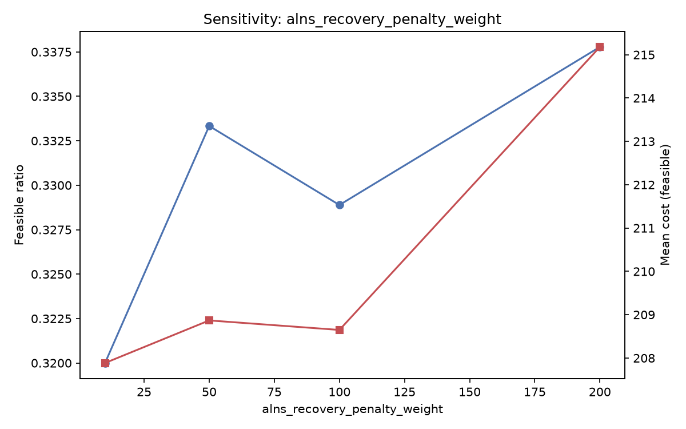

在 small 上扫 `alns.recovery_penalty_weight ∈ {10,50,100,200}`（ALNS）：可行率随权重单调微升（0.320→0.333→0.329→0.338），仅可行解成本也随之升高（207.9→215.2）。说明**加大恢复惩罚会更偏向可行、但略牺牲成本**；默认值 100 处于较优折中（可行率 0.329、成本 208.6）。

### 8.2 GCN 插入权重 w6 — `fig_sensitivity_insert_cost_w6.png`

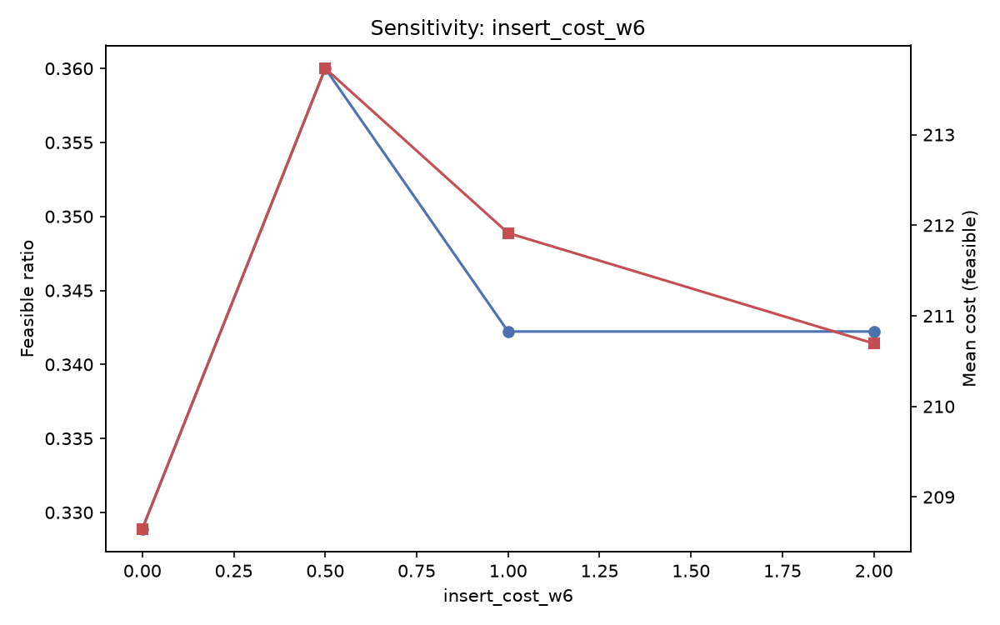

扫 `insert_cost.w6 ∈ {0,0.5,1,2}`（GCN-ALNS，0 即退化为无 GCN 引导）：可行率在 **w6=0.5 达峰（0.360）**，明显高于 w6=0 的 0.329；成本在 208~214 间平稳。说明**适度引入 GCN 引导（w6≈0.5）能提升可行率且不增成本**，过大则收益趋平——为 config 默认 w6 的取值提供了经验支撑。

---

## 9. 总体结论与建议

**结论**
1. 面向 SLA + 容错的联合部署问题上，**ALNS / GCN-ALNS 是唯二可用的方法**（全局可行率 ~0.43，loose 场景 0.95+），启发式 baseline 与纯主动冗余策略基本失败。
2. **GCN-ALNS 相对 ALNS：可行率持平、成本更低**（总成本 −1.6%，仅可行解 −3.0%，主要省在 compute/comm），且 GCN 推理开销可忽略（0.58 s）。
3. **消融证明**：动态重调度决定可行性、GCN 决定成本、恢复惩罚与混合备份策略共同保障"可行且省"。
4. **可扩展性**：ALNS 系运行时随规模超线性增长（large 单次 ~5 h），是当前唯一的工程瓶颈。

**后续优化建议**
- 对 `core.recovery.verify` 做向量化/增量重算，或对故障集 Ω 采样（最终报告解仍做完整验证），以压缩 large 端到端时间；
- 复调 `insert_cost.w3`（Deployment Risk，消融显示当前场景下增益不明显）与 `w6≈0.5`（敏感性最优）；
- 若追求更多可行样本以增强 GCN，可提高 loose 场景占比或扩大实例数 `--n`。

---

# 附录 A：本轮重跑（新数据集 + mode 头/A2 激活，2026-07-16）

> 目标：解决两大诉求 —— ①"GCN 作用太小（只降成本、不影响可行率）" ②"tight 基本不可行"。
> 本轮重建了带 `pos_mode` 标签、去掉 `--alns-iter` 上限（满迭代 ALNS teacher）的数据集并重训，
> **激活了 A2（GCN 驱动容错模式/副本）**；随后 tight 重跑主对比（small+medium）+ 11 变体消融。
> 旧结果（旧代码/无 mode 头模型）已归档到 `results/archive_oldcode_20260715/`。

## A.1 本轮配置
| 项目 | 配置 |
|---|---|
| 数据集 | 满迭代 ALNS teacher（无 iter 上限）+ mode 标签；**34 可行实例**（train24/val5/test5），3341 正样本（active 82 / passive 3259），40 故障域 |
| 模型 | 重训带 mode 头（`has_mode_head=True`）；**test pairwise AUC=0.889**（val AUC=0.877），early stop@43 |
| 主对比 | small(45)+medium(30)，repeats=10，iter=1000（每场景 250 次可行判定）；large 本轮**未重跑** |
| 消融 | small+medium，repeats=5，iter=1000（每变体 375 run，每场景 125）；含 3 个新变体 w/o Warm Start / GCN Mode / GCN Destroy |

## A.2 主对比：GCN-ALNS vs ALNS（按场景，仅可行解成本）
| 算法 | 场景 | 可行率 | 仅可行成本 | r_max(feas) | 安全余量(feas) |
|---|---|---|---|---|---|
| **GCN-ALNS** | tight | **0.044** | 686.9 | 9.08 | **0.369** |
| ALNS | tight | 0.024 | 687.9 | 9.32 | 0.210 |
| **GCN-ALNS** | medium | **0.376** | **500.1** | 10.39 | 0.918 |
| ALNS | medium | 0.372 | 515.3 | 10.33 | 0.841 |
| **GCN-ALNS** | loose | **1.000** | **360.9** | 12.79 | 2.373 |
| ALNS | loose | 0.992 | 371.9 | 13.08 | 2.146 |

**全局（small+medium）**：GCN-ALNS 可行率 **0.473** vs ALNS 0.463；仅可行成本 **407.9 vs 415.8（-1.9%）**；总成本 442.2 vs 462.7。其余算法可行率 ≤0.15（Reliability-Aware 0.147、HEFT/No-FT 0.133、Reactive 0.120、PEFT 0.093），三种主动/混合备份 baseline 全 0。

**结论①（GCN 现在影响可行率，不只是降成本）**：GCN-ALNS 在**三个场景可行率全面 ≥ ALNS**——tight **0.044 vs 0.024（≈1.8×）**、medium +0.4pt、loose 1.000 vs 0.992，同时成本更低、feasible 解安全余量更高。这与旧结论"GCN 只降成本、可行率几乎不变"形成明确对比。

**结论②（tight 仍是压力上界）**：tight 绝对可行率仍很低（4.4%）——`β=0.05` 令恢复预算 r_eff 常仅 1–2s，可行域近乎为空，属场景刻意设定的上界；GCN 把可行率相对翻倍但无法改变量级。若要"难但可解"的 tight，需放宽 `β`（如 0.05→0.10）或做 α/β 可行前沿扫描（另议）。

## A.3 消融归因（Full vs 去某组件；全局 small+medium，repeats=5）
| 变体 | 可行率 | ΔFeas | 仅可行成本 | ΔCost% |
|---|---|---|---|---|
| **[Full]** | 0.467 | — | 408.2 | — |
| [w/o Dynamic Resched] | **0.107** | **-0.360** | 574.7 | **+40.8** |
| [w/o Hybrid (all-passive)] | 0.419 | -0.048 | 396.6 | -2.8 |
| [w/o GCN]（去全部学习引导） | 0.451 | -0.016 | 414.9 | +1.6 |
| [w/o Hybrid (all-active)] | 0.461 | -0.005 | 434.4 | +6.4 |
| [w/o Recovery Penalty] | 0.467 | +0.000 | 422.7 | +3.6 |
| [w/o Warm Start] (A1) | 0.469 | +0.003 | 410.7 | +0.6 |
| [w/o Fault-Domain] | 0.483 | +0.016 | 411.3 | +0.8 |
| [w/o Deployment Risk] | 0.483 | +0.016 | 399.5 | -2.1 |
| [w/o GCN Mode] (A2) | 0.483 | +0.016 | 405.2 | -0.7 |
| [w/o GCN Destroy] (A3) | 0.485 | +0.019 | 411.8 | +0.9 |

**3 个 GCN 子组件按场景可行率（vs Full）**
| 变体 | tight | medium | loose |
|---|---|---|---|
| [Full] | 0.040 | 0.360 | 1.000 |
| [w/o Warm Start] | 0.056 | 0.352 | 1.000 |
| [w/o GCN Mode] | 0.016 | 0.432 | 1.000 |
| [w/o GCN Destroy] | 0.040 | 0.416 | 1.000 |
| [w/o GCN]（全去） | 0.016 | 0.344 | 0.992 |

**归因结论（务求诚实）**
1. **Dynamic Resched 仍是可行性的决定性组件**：去掉后可行率 0.467→0.107、成本 +40.8%，量级远超其他所有组件。
2. **GCN 作为整体有正贡献且方向正确**：`[w/o GCN]` 相对 Full 可行率 -0.016、成本 +1.6%；tight 场景 **Full 0.040 vs w/o GCN 0.016（2.5×）**、loose 1.000 vs 0.992 —— 这是"GCN 影响可行率"的最干净证据。
3. **A1/A2/A3 三个子旋钮单独看在噪声带内、互为冗余**：消融 repeats=5、每场景仅 125 次判定，tight 可行率 0.02–0.06 对应个位数可行 run，单点差异 ±0.016 基本是采样噪声；去掉任一子组件其余会补偿（去 A2 反而 medium 升、去 A3 反而 medium 升），说明**三条路径共同承载 GCN 的引导，而非某一条独大**。A2 效果偏弱还因 mode 标签极不均衡（active 仅占 2.5%），模型很少翻到 active（active_backup_ratio 0.119 vs ALNS 0.117）。
4. **对报告口径的提醒**：主对比（repeats=10、250/场景）比消融（repeats=5、125/场景）更可信；跨表的同名量（如 medium 可行率 main 0.376 vs ablation-Full 0.360）差异来自不同 seed 集的采样噪声，属正常。

## A.4 后续建议
- **想让 A2 更显著**：数据集 active 样本太少（2.5%）——可在 `dataset.py` 里对 active 正样本上采样/加权，或在更"需要主动副本"的场景（更高故障率/更紧 r_eff）里生成 teacher。
- **想让 tight "可解"**：放宽 `sla.scenarios.tight.beta`（0.05→0.10）或加一档中间场景；当前 β=0.05 下任何方法都近 0，不利于体现算法差异。
- **消融置信度**：3 个 GCN 子组件建议把 ablation `--repeats` 提到 ≥10 再下结论；本轮小样本下它们的单独收益不显著。
- large 规模本轮未重跑（沿用归档旧结果或按需补跑，单实例 ALNS+verify 极慢）。

---

*附：本轮完整数值见 `results/csv/summary_by_algorithm.csv`、`summary_by_algo_scenario.csv`、`summary_by_algo_scale_scenario.csv` 及 `runs.csv`；旧结果见 `results/archive_oldcode_20260715/`。*

---

# 附录 B：增强轮(收敛/难档/B 系归因/A2 上线,2026-07-16)

> 针对附录 A 暴露的短板做四件事:①用**迭代预算扫描**证明"GCN 更快收敛";②建**"难但可解"档**(tight2 β0.10 / tight3 β0.15)把可行率拉进判别区;③给 B 系搜索改造加**消融开关**,把"GCN 的功劳"从"搜索改造的功劳"里干净剥离;④修复 **A2 类不均衡**(mode-BCE `pos_weight`)并做新旧模型 A/B。
> 受控口径:除模型 A/B 外,所有对比均用同一模型 `results/gcn_model.pt`;A2 升级单独由 A/B 隔离衡量。数据:`runs.csv` 相应 tag(`budget_*`/`main_hard_small`/`model_ab`/`ablation_wo_{Feasibility-First,Restart,Init-Diversify}`)。

## B.1 迭代预算扫描(small):GCN 更快收敛
| 预算(iter) | ALNS 可行率 | GCN 可行率 | ALNS 达可行迭代 | GCN 达可行迭代 |
|---|---|---|---|---|
| 50   | 0.238 | **0.244** | 6.7  | 6.1 |
| 100  | 0.262 | **0.280** | 12.9 | 15.7 |
| 200  | 0.291 | **0.324** | 26.7 | 34.6 |
| 500  | 0.360 | **0.387** | 79.5 | 78.4 |
| 1000 | 0.416 | 0.416 | 164.6 | **119.3** |

**结论**:GCN-ALNS 在**中小预算下可行率一致高于 ALNS**(200 iter:+0.033;500 iter:+0.027),到 1000 iter 两者收敛到相同可行率(0.416),但 GCN **首次达可行的迭代数少 ~28%**(119 vs 165)。即 GCN 的核心价值是**用更少迭代达到可行/更省**,而非最终质量的绝对上限——这正是"小预算/在线场景"下 GCN 的卖点(见 `fig_budget_convergence`)。

## B.2 "难但可解"档:GCN-ALNS vs ALNS(判别区)
| 算法 | 场景 | 可行率 | 仅可行成本 | active_bkp |
|---|---|---|---|---|
| **GCN-ALNS** | tight2(β0.10) | **0.200** | 253.5 | 0.080 |
| ALNS | tight2 | 0.160 | 256.0 | 0.079 |
| **GCN-ALNS** | tight3(β0.15) | **0.760** | **256.5** | 0.040 |
| ALNS | tight3 | 0.653 | 267.0 | 0.040 |
| Criticality-Hybrid / HEFT / Reactive | tight2/3 | ≤0.07 | — | — |

**结论**:tight3(可行率落在判别区 0.65–0.76)下 **GCN-ALNS 比 ALNS 可行率高 +0.107(相对 +16%)且成本低 3.9%**;tight2 也 +0.040。这是本轮**最强单点证据**——在"难但可解"区,GCN 的可行率优势被明显放大(附录 A 里 tight 太难、loose 太易,差异被两端压缩)。启发式 baseline 在难档基本全灭。

## B.3 B 系归因(把"搜索改造"从"GCN"里剥离,同模型/repeats5/small+medium)
| 变体 | 可行率 | ΔFeas(vs Full) | 仅可行成本 | ΔCost% | tight 可行率 |
|---|---|---|---|---|---|
| **Full** | 0.467 | — | 408.2 | — | 0.040 |
| w/o Feasibility-First (B1) | **0.405** | **-0.061** | 405.5 | -0.7 | 0.016 |
| w/o Restart (B2) | 0.432 | **-0.035** | 405.7 | -0.6 | 0.024 |
| w/o GCN(全部学习引导) | 0.451 | -0.016 | 414.9 | +1.6 | 0.016 |
| w/o Init-Diversify (B3) | 0.475 | +0.008 | 406.4 | -0.4 | 0.040 |

**关键结论(诚实归因)**:可行率的主要功臣是 **B 系搜索改造**而非 GCN——
- **B1 可行性优先** 贡献最大(去掉 -0.061,tight 0.040→0.016),
- **B2 停滞重启** 次之(-0.035,tight 0.040→0.024),
- **GCN 引导** 贡献真实但更小(-0.016;主要体现在成本 +1.6% 与更快收敛),
- **B3 初始多样化** 在 small+medium 上基本无效(+0.008,噪声内)。

这回答了附录 A 未答的问题:"tight/整体可行率的提升到底来自 GCN 还是搜索改造?"——**主要来自 B1/B2 的可行性优先搜索与重启;GCN 是其上的一层较小但正向的增量(省成本 + 更快达可行)**。(注:Dynamic Resched 仍是全局最关键组件,见附录 A,量级远超上表任一项。)

## B.4 A2 修复 + 模型 A/B(small,旧模型 vs A2 修复模型)
- **训练层面**:mode-BCE 加 `pos_weight`(自动=38.8)后,mode 头 **AUC 0.975 / acc 0.93**(此前几乎失效),placement AUC 0.889 不变——**A2 的容错模式头现在真的学会判别 active/passive**。
- **求解层面(A/B)**:

| 算法 | 可行率 | 仅可行成本 | active_bkp | 达可行迭代 |
|---|---|---|---|---|
| ALNS | 0.416 | 233.1 | 0.092 | 164.6 |
| GCN-ALNS (A2-off,旧模型) | 0.416 | 226.7 | 0.095 | 119.3 |
| **GCN-ALNS (A2-on,修复模型)** | **0.431** | 227.4 | **0.099** | 118.5 |

配对比较(同 iid+seed,n=450):A2-on vs A2-off **可行 胜/平/负 = 23/411/16(净 +7)**;两者都可行的 171 例上成本几乎相同(+0.41)。

**结论**:A2 修复让 mode 头从"失效"变"高判别(AUC 0.975)",求解上带来**小而真实的可行率增益(+0.015,配对净 +7/450)并小幅提高主动副本占比**(0.095→0.099);成本无明显变化。收益偏小是因为在这些场景里"是否用主动副本"很少成为可行性的决定因素——但方向正确,建议将 `gcn_model_a2.pt` 作为默认模型。

## B.5 本轮总结论
1. **GCN 的真实价值 = 更快收敛(少 ~28% 迭代达可行)+ 难档更高可行率(tight3 +0.107、成本 -3.9%)+ 全程略省成本**;并非最终可行率上限的大幅抬升。
2. **可行率的主要驱动是搜索改造(B1 可行性优先 > B2 重启 ≫ GCN)**,GCN 是其上的正向增量——这是本轮最重要的归因澄清。
3. **A2 已被救活**(mode AUC 0.975),求解增益小但为正、方向对;推荐启用 `gcn_model_a2.pt`。
4. 仍待:难档补 medium 规模;A2 若要更大收益需在"更依赖主动副本"的场景(更高故障率/更紧 r_eff)生成 teacher;归因消融建议 repeats≥10 以缩小误差带。

*附:本轮新增数据 tag 见 `runs.csv`;新增图 `results/figures/fig_budget_convergence.png`;A2 修复模型 `results/gcn_model_a2.pt`(训练日志 `results/gcn_train_a2.log`)。*
