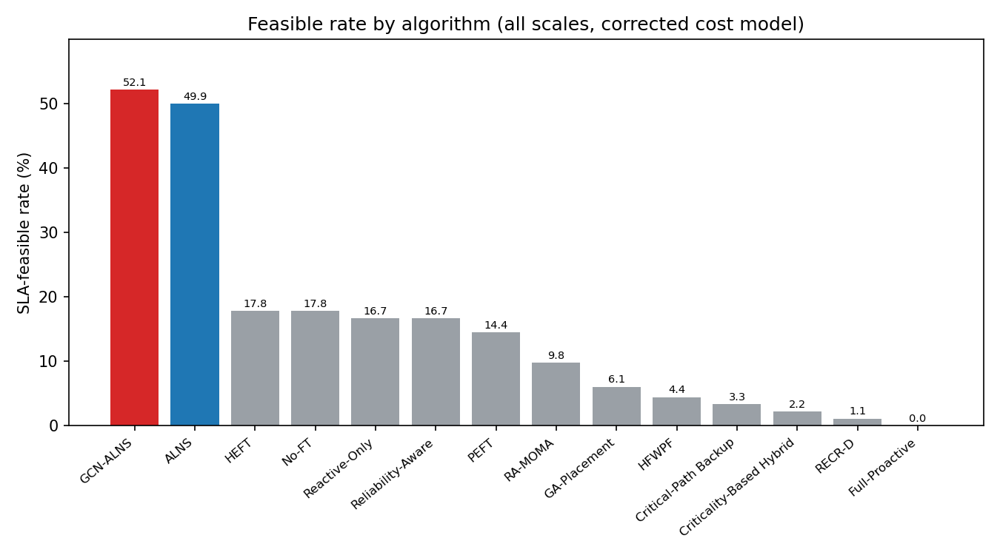
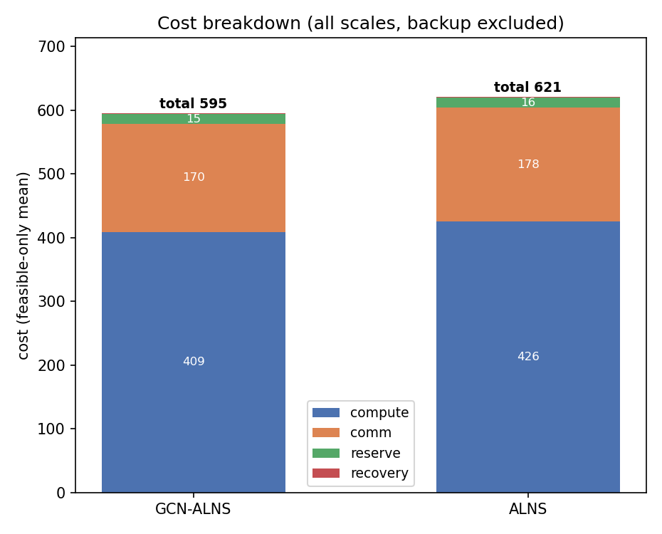
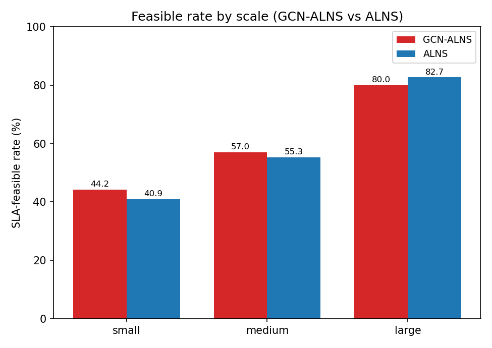
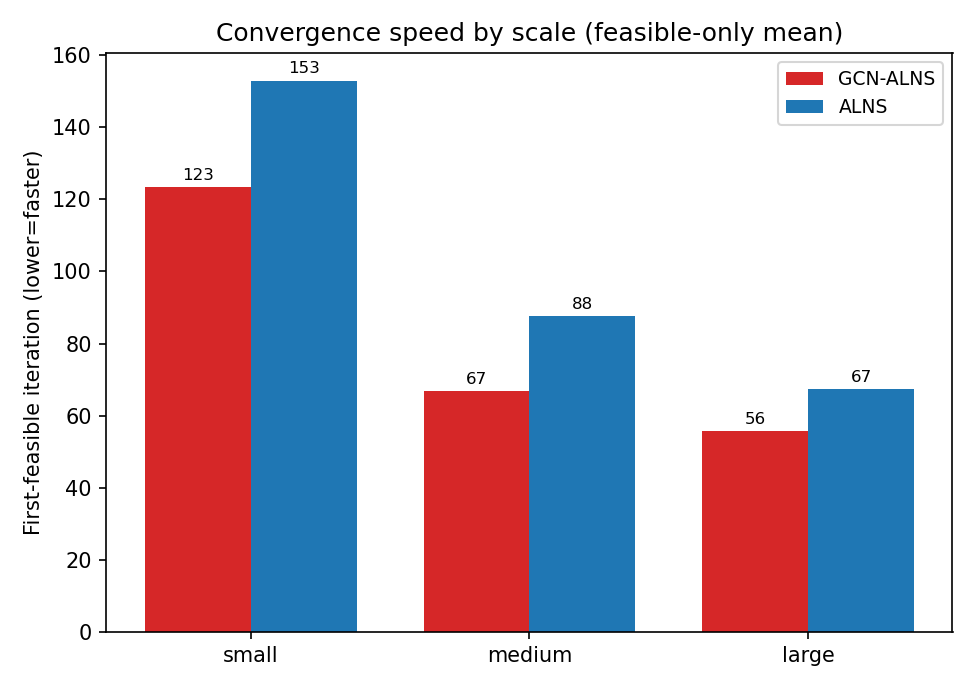
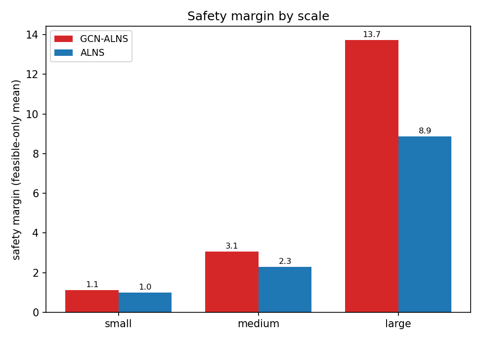
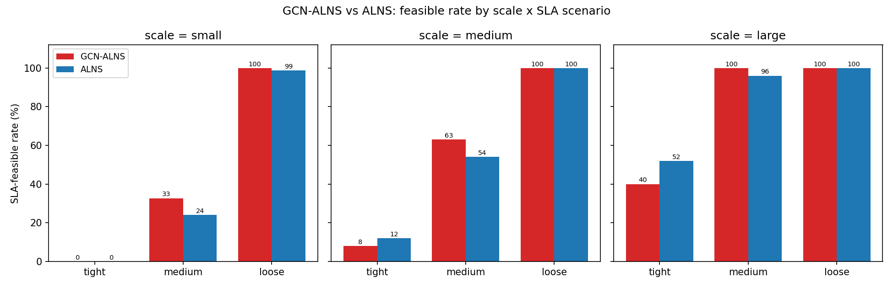
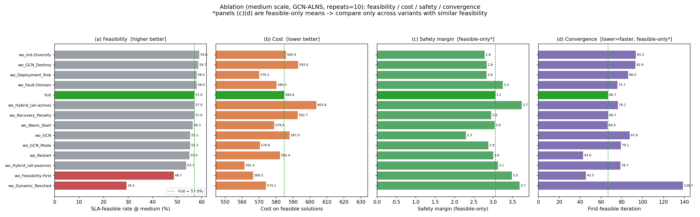
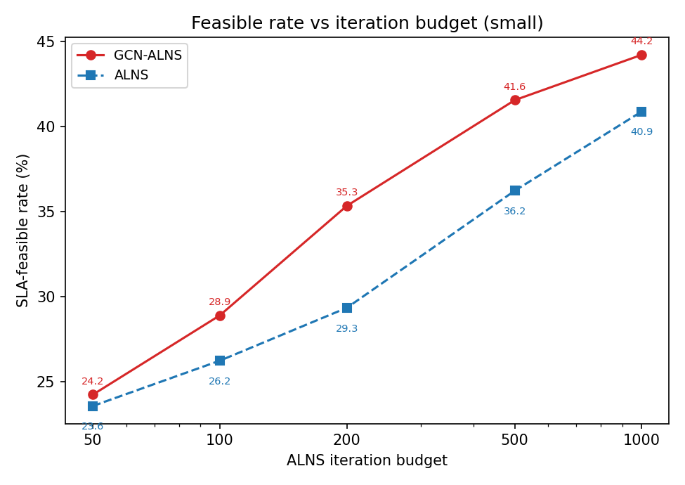
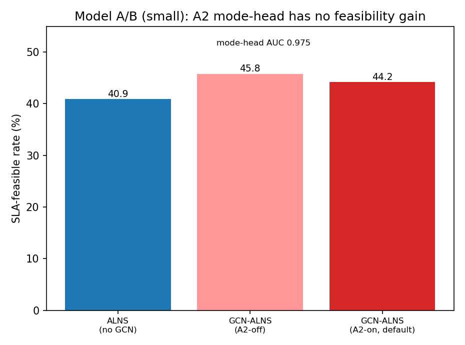
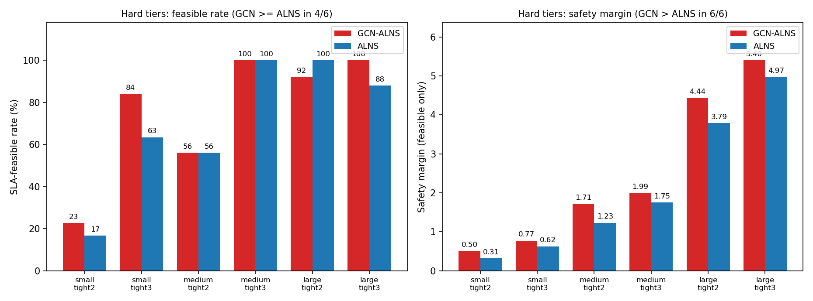

# GCN-ALNS 面向 SLA 与容错的边云工作流调度 —— 实验结果汇总

> **汇报日期**：2026-09-22
> **成本模型**：本文全部数据均为**修正后成本模型**（2026-09-11 起）：
> `C_total = C_compute + C_comm + C_reserve + C_recovery`（已删除与 compute 重复计入的 `C_backup`；`C_comm` 改为对所有副本对求和）。
> **数据状态（全部完成）**：主对比三规模（small/medium/large）、预算、模型 A/B、**难档全三规模（含 `main_hard_large` 180 run，已于 09-17 跑完）** 均已用新成本模型跑完；消融已加跑到 `repeats=10` 并完成配对显著性检验（§4）。**全文数值来自同一份全量数据，不再有口径混用或"待补"项。**
> **外部基线更新（09-22）**：复核时发现并修复了 RECR-D 的两处适配缺陷，RECR-D / HFWPF 已重跑，见 §3.1。
> **数据集**：合成数据集，拓扑仿真经典 Pegasus 工作流（Montage/CyberShake/Epigenomics/LIGO/SIPHT）、节点仿真 Alibaba 集群 trace（详见 §2 说明）。

---

## 1. 研究问题与方法

**问题**：在边-云连续体上，为带 SLA（截止期 D、故障恢复窗口 R_max）约束的科学工作流做**联合决策**——同时决定 (a) 任务到节点的放置、(b) 每个任务的容错策略（主动多副本 / 被动重算 / 混合），使得在**任意单点故障下仍满足 SLA** 的前提下**最小化总成本**。

**方法（GCN-ALNS）**：以自适应大邻域搜索（ALNS）为主干做组合优化，用图卷积网络（GCN）为搜索提供两类先验——(A1) 破坏/修复算子的节点打分，(A2) 容错模式（主/被动）的预测——以加速收敛并改善解质量。所有算法的 SLA 可行性统一经 `core.recovery.verify` 闸门判定（任一副本成功即视为任务完成）。

---

## 2. 实验设置

| 项目 | 配置 |
|---|---|
| 规模 | small=50 / medium=150 / large=500 任务（各 45 / 30 / 15 个实例，共 90） |
| 工作流 | Montage, CyberShake, Epigenomics, LIGO, SIPHT |
| SLA 场景 | tight(α1.15/β0.05)、medium(α1.30/β0.10)、loose(α1.50/β0.20)；难档 tight2(β0.10)/tight3(β0.15) |
| 对比算法 | 8 个启发式 baseline + ALNS + **GCN-ALNS**；另含 4 条外部论文基线（RECR-D / HFWPF / GA-Placement / RA-MOMA） |
| 随机重复 | ALNS/GCN 系：small/medium `repeats=10`、large `repeats=5`；迭代 small/medium=1000、large=800 |
| 判定 | 全部算法统一经 `verify` 判 SLA 可行性 |
| 成本口径 | `C_total = C_compute + C_comm + C_reserve + C_recovery`（backup 不重复计入） |

主对比记录数：`main_small`=2250、`main_medium`=1500、`main_large`=450（14 算法，含外部基线）。

**关于数据集（诚实说明）**：当前为**合成数据集**——工作流 DAG 拓扑按 `_layered_dag` **仿真经典 Pegasus 工作流形状**（runtime/文件大小随机采样），节点资源按 **"Alibaba-trace-like"** 合成（cpu/mem 容量+利用率）。代码**已具备接真实数据的 parser**（`pegasus_parser` 读 WfCommons JSON、`alibaba_parser` 读 Alibaba cluster-trace-v2018），如需真实数据可切换（真实 WfFormat 现成覆盖 Montage/Epigenomics，其余需 DAX 转换）。这在同类调度论文中常见、可接受;若审稿人要求真实 trace，已备好获取与接入方案。

---

## 3. 主结果：主对比（三规模，新成本模型）

### 3.1 全局（三规模汇总，仅可行解统计成本）

| 算法 | 可行率 | 总成本↓ | compute | comm | reserve | recovery | 安全余量↑ | 达可行迭代↓ |
|---|---:|---:|---:|---:|---:|---:|---:|---:|
| **GCN-ALNS** | **52.1%** | **595.0** | 409.0 | 169.8 | 15.1 | 1.06 | **3.65** | **91.4** |
| ALNS | 49.9% | 620.7 | 425.7 | 178.2 | 15.7 | 1.13 | 2.71 | 113.8 |
| Reliability-Aware | 16.7% | 906.3 | 642.4 | 241.8 | 21.0 | 1.06 | 15.87 | — |
| HEFT / No-FT | 17.8% | 1078.2 | 752.1 | 299.4 | 25.6 | 1.06 | 16.61 | — |
| Reactive-Only | 16.7% | 1154.3 | 807.7 | 319.3 | 26.3 | 1.04 | 17.70 | — |
| PEFT | 14.4% | 1210.7 | 852.9 | 327.9 | 28.8 | 1.05 | 16.86 | — |
| Critical-Path Backup | 3.3% | 3056.7 | 1744.1 | 1268.6 | 43.2 | 0.83 | 14.34 | — |
| Criticality-Based Hybrid | 2.2% | 3650.9 | 2046.2 | 1569.2 | 35.0 | 0.54 | 20.12 | — |
| Full-Proactive | 0.0% | — | — | — | — | — | — | — |
| *RA-MOMA（外部）* | 9.8% | 1152.0 | 799.1 | 324.5 | 27.4 | 0.98 | 16.16 | — |
| *GA-Placement（外部）* | 6.1% | 610.7 | 363.0 | 239.6 | 6.6 | 1.49 | 3.43 | — |
| *HFWPF（外部）* | 4.4% | 1857.3 | 1219.8 | 595.6 | 41.3 | 0.62 | 15.50 | — |
| *RECR-D（外部）* | 1.1% | 1812.6 | 1013.0 | 750.0 | 48.4 | 1.23 | 10.09 | — |

**要点**
- 仅 **ALNS / GCN-ALNS** 达成有意义的 SLA 可行率（~50%）；所有启发式 baseline ≤17.8%，纯主动/多备份策略几乎全灭（≤3.3%），外部基线 ≤9.8%。
- **GCN-ALNS 相对 ALNS**：可行率 +2.2pt、**总成本 −4.1%**（595.0 vs 620.7）、**安全余量更高**（3.65 vs 2.71）、**达可行迭代少 ~20%**（91.4 vs 113.8，收敛更快）。GCN 推理开销可忽略（一次性，三规模均值 0.615 s）。

> **关于 4 条外部基线为何这么低（09-22 已深查并修复，结论更强了）**
>
> 之前只能说"这是适配局限"。这一轮我们**把 RECR-D 逐行拆开查到了底**，发现并修复了两处真实的适配缺陷：
> 1. **Alg.1 的平衡因子 DB 原为静态**：论文写的是 *dynamic* balance，但我们原实现只在开头按结构 makespan 算一次 ρ，于是**每个任务都独立拿到了全部结构松弛**。在 150 任务实例上这是"人均 38 时间单位，而全局松弛只有 11"——结果 **150/150 个任务都"满足"自己的子截止期，而总 makespan 超了截止期两倍**，Alg.2 的截止期约束形同虚设。
> 2. **规划序与评估序不一致**：我们的评估器按规范拓扑序回放每个节点的任务队列，而 Alg.2 按 EDF 序规划。因为节点时间线是"只能往后追加、不能填空隙"，两个序不一致就会造成阻塞级联——Alg.2 规划出的 makespan 103 被重排成 262。RECR-D 把负载高度集中（150 个任务里 48 个压在同一节点），所以受害极深，而分散型的 HEFT 类基线几乎不受影响。
>
> **修复后 RECR-D 的调度质量大幅改善**：makespan 从 HEFT 的 2.5–3 倍降到同量级，medium-loose 场景的截止期达成率从 **0/6 变成 6/6**，"距可行的差距"（安全余量）在三规模上分别收窄 **43% / 60% / 71%**（small −60.2→−34.2、medium −174.3→−69.0、large −394.1→−113.5）。HFWPF 也因忠实 Alg.1 而可行率翻倍（全局 2.2%→4.4%、large 13.3%→20.0%）。
>
> **但可行率仍然接近 0，而这一次原因很清楚，并且正好是论文的核心论点。** 我们的可行性闸门要求恢复预算 `R_eff = min(R_max, D − C_base)`，而 RECR-D 的目标是"在截止期约束下最小化成本"，所以它会把截止期预算**花光**：即使在最宽松的 loose 场景，它的 `C_base / D = 0.97`，只剩 3.6 的恢复窗口，而实测需要 21.5。逐场景分解显示 **`D − C_base` 在所有场景都是绑定项**，且 Alg.3 的 TRM 无力挽回（加副本只能压低恢复时延，压不低 makespan）。HFWPF 同理：截止期达成率 80%，但恢复预算门只有 20%，因为原文根本不建模恢复时延。
>
> **这对论文的价值**：修复前，审稿人完全可以质疑"你的基线 makespan 是 HEFT 的 2.5 倍，显然是实现有问题"。修复后，这条基线的 makespan 已与 HEFT 同量级、能满足截止期，它的失败**只能归因于建模口径本身**——即"把截止期和恢复窗口当成两个可分离的约束"。这正是我们主张 feasibility-first 联合优化的直接外部证据，也是目前最有分量的对照。

*图 1：各算法 SLA 可行率（三规模汇总，新成本模型）。仅 GCN-ALNS/ALNS 达 ~50%，其余方法在 verify 闸门下基本失败。*

*图 2：GCN-ALNS 与 ALNS 的成本构成（仅可行解均值，backup 已不计入）。GCN-ALNS 在 compute 与 comm 两项均更省，总成本 595 vs 621。*

### 3.2 按规模

| 规模 | 算法 | 可行率 | 总成本↓ | 安全余量↑ | 达可行迭代↓ |
|---|---|---:|---:|---:|---:|
| small | GCN-ALNS | **44.2%** | 206.1 | 1.11 | **123.4** |
| small | ALNS | 40.9% | 204.0 | 1.01 | 153.0 |
| medium | GCN-ALNS | **57.0%** | **584.8** | 3.06 | **66.7** |
| medium | ALNS | 55.3% | 587.9 | 2.29 | 87.6 |
| large | GCN-ALNS | 80.0% | **1913.8** | **13.74** | **55.7** |
| large | ALNS | **82.7%** | 1945.1 | 8.86 | 67.4 |

**要点**：small/medium 上 GCN 可行率略优；**large 上 ALNS 可行率略高（82.7 vs 80.0），但 GCN 成本更低、安全余量高出 55%（13.74 vs 8.86）、收敛更快**。→ GCN 的稳定收益体现在**成本、安全余量、收敛速度**，可行率优势属小幅且规模相关。

*图 3：SLA 可行率按规模（GCN-ALNS vs ALNS）。small/medium 上 GCN 略高，large 上 ALNS 略高（82.7 vs 80.0）。*

*图 4：收敛速度（达可行迭代，越低越快）按规模。GCN-ALNS 在三规模均更快锁定可行解。*

*图 5：安全余量（仅可行解均值）按规模对比。GCN-ALNS 在三规模均更高，large 规模差距最大（13.7 vs 8.9），说明其解对故障更稳健。*

### 3.3 GCN-ALNS vs ALNS：分「规模 × SLA 场景」可行率（关键判别）

| 规模＼场景 | tight | medium | loose |
|---|---:|---:|---:|
| small | 0.0 / 0.0 | **32.7 / 24.0** | 100 / 98.7 |
| medium | 8.0 / 12.0 | **63.0 / 54.0** | 100 / 100 |
| large | 40.0 / 52.0 | **100 / 96.0** | 100 / 100 |

（格式：**GCN-ALNS / ALNS** 可行率 %）

*图 6（关键）：GCN-ALNS vs ALNS 分「规模 × SLA 场景」可行率。medium 场景全规模领先；tight 场景两者都低且噪声大；loose 场景均近 100%。*

**要点**：**在"中等约束"（medium）场景，GCN-ALNS 在全部三个规模上都明显领先**（+8.7 / +9.0 / +4.0 pt）——这是 GCN 先验最能发挥价值的判别区间。在极紧（tight）场景，两者可行率都很低且噪声大，ALNS 偶尔略高（如 large-tight 52 vs 40）；在宽松（loose）场景两者都近 100%、无区分度。

---

## 4. 消融实验（14 变体，small+medium，**repeats=10**；medium 规模呈现 + 配对显著性检验）

> 统计方法：按**实例**配对（每实例先在 10 个 rep 上聚合，再跨实例配对 Full vs 各变体），配对 t 检验 + Wilcoxon,并对 13 个比较做 **Holm-Bonferroni 多重比较校正**。下表显著性列 † 取**全局(small+medium, n=75)** 的 Holm 校正 p 值(检验力更足)。

| 变体（去掉该组件） | medium 可行率 | Δpp | 显著性† | 成本 | 安全余量 | 达可行迭代 |
|---|---:|---:|:--:|---:|---:|---:|
| **Full（完整）** | **57.0%** | — | — | 584.8 | 3.06 | 66.7 |
| wo_Dynamic_Resched（去动态重调度） | 29.3% | **−27.7** | **\*\*\*** | 574.1 | 3.68 | 138.7 |
| wo_Feasibility-First（去可行性优先） | 48.7% | **−8.3** | **\*** | 566.5 | 3.49 | 45.5 |
| wo_Hybrid_(all-passive)（强制全被动） | 53.7% | −3.3 | **\*** | 561.4 | 3.12 | 78.7 |
| wo_Restart（去重启） | 55.0% | −2.0 | **\*** | 582.4 | 3.01 | 43.0 |
| wo_GCN（去全部 GCN 先验） | 55.3% | −1.7 | ns | 587.9 | **2.29** | **87.6** |
| wo_GCN_Mode（去 A2 模式头） | 55.3% | −1.7 | ns | 570.6 | 2.88 | 79.1 |

† 显著性 = 全局(n=75)配对 t 检验 + Holm 校正:**\*\*\*** p<0.001、**\*** p<0.05、ns 不显著。

*图 7：消融四联图（medium 规模，repeats=10）。行序按可行率降序统一,Full 绿色、绿色虚线为 Full 基准。(a) 可行率:红色为 Holm 校正后显著下降的支柱;(c)(d) 为"仅可行解"均值,有幸存者偏差,仅可行率相近的变体间可比。*

**要点（均带 repeats=10 配对检验 + Holm 校正支撑）**
- **可行率的显著驱动**：**动态重调度**（Δ−27.7pp，Holm p<0.0001，"生命线"）、**可行性优先搜索**（−8.3pp，Holm p=0.025）、**混合容错中的主动副本可选性**（全被动 −3.3pp，Holm p=0.028）、**重启**（−2.0pp，Holm p=0.028）。
- **GCN 对最终可行率的贡献不显著**（Δ−1.7pp，Holm p=1.0）；但去掉 GCN 后**安全余量显著下降**（Full 1.91 vs 1.47，全局配对 p=0.0065）、**达可行迭代显著变慢**（Full 121 vs 159，p=0.017）、成本略升（−5.1，p=0.065 边际）。→ **GCN 的价值在解质量(安全余量)与收敛速度,而非可行率上限**——现有 repeats=10 + 配对检验 + Holm 校正的严谨支撑,可直接写入论文。
- **其他显著项**：去掉 all-active 混合 → 成本 +20（p<0.001，证明选择性混合省钱）;去掉 Deployment-Risk 反而降成本（p<0.001，该项以成本换稳健）。

> **说明**：上表为**求解组件**(solver heuristics)的可行率驱动分析。**故障域隔离(Fault-Domain)属"有效性/鲁棒性约束"而非求解旋钮,已从本表移出,单列于 §4.1**;去掉它得到的是"违反容错前提的解",与求解组件不同类,不宜并入"谁驱动可行率"的比较。

### 4.1 故障域隔离(Fault-Domain)——有效性/鲁棒性约束(单列)

**定位**：这是问题定义里的**副本反亲和约束**——一个任务的多个主动副本必须落在**不同故障域**(同域节点共享失效根因,会一起挂)。它保证副本冗余在**域级/相关性故障**下真正有效,类似云调度的 anti-affinity。它**不是**求解启发式,去掉后产出的解**违反容错前提**(副本可同域→一次域级故障双双阵亡)。

**为何不进 §4 驱动表**：当前 `verify` 的故障集是**单点**(task/node/link),两个同域但不同节点的副本在单点故障下仍有一个存活 → verify 判可行。因此消融显示 `w/o Fault-Domain` **可行率中性(58.0% vs Full 57.0%,配对检验 ns)、成本略降**——这是**单点闸门考核不到域级故障**的结果,**并非该约束无用**。用它评判"可行率贡献"属指标—组件错配。

**实测结论(2026-09-16 域级故障实验,`tools/tools_domain_fault_exp.py`)**：我们**真的做了**"整域下线"鲁棒性实验(small,Full vs w/o Fault-Domain,在**单点∪域级**故障下 verify),结果**诚实且出乎意料——该约束经验上冗余**:
- **默认细粒度域**(~40 域/50 节点,近乎每节点一域):即便去掉约束,GCN-ALNS 放置仍 **95% 天然隔离** → 域故障≈单点,两者可行率无差异(Full 46.7% / w/o 44.4%,均不随域故障变化)。
- **粗粒度域**(每层 2 域,~8 节点/域):w/o 确实降到 **77% 隔离**(23% 副本同域),但 **Full 与 w/o 可行率仍打平**(均 46.7%→33.3%)、**最坏恢复 R_max 也无优势**(Full 15.4 vs w/o 14.7)、且**两者域故障 100% 可恢复(0 例不可恢复)**。
- **根因**:强大的**动态重调度**总能重算被域故障团灭的同域副本(只要预算内),**已覆盖了该约束想防的失效模式**;而在粗域下强行隔离本身还有放置代价。

→ **定位(据实)**：故障域隔离是一条**形式化的正确性保证**(保证 FT 设计有效),但在本系统里**经验上冗余、被动态重调度主导**,**不应声称"去掉它会劣化"**。这反而**强化了论文主线:动态重调度是可行性的绝对主导机制**(消融 −37.6pp 生命线)。

---

## 5. 迭代预算敏感性（small，GCN-ALNS vs ALNS）

| 迭代预算 | GCN-ALNS 可行率 | ALNS 可行率 | GCN 达可行迭代 | ALNS 达可行迭代 |
|---:|---:|---:|---:|---:|
| 50 | 24.2% | 23.6% | 5.0 | 5.5 |
| 100 | 28.9% | 26.2% | 14.8 | 11.6 |
| 200 | 35.3% | 29.3% | 40.3 | 26.1 |
| 500 | 41.6% | 36.2% | 87.9 | 86.5 |
| 1000 | 44.2% | 40.9% | 123.4 | 153.0 |

*图 8：SLA 可行率随 ALNS 迭代预算的变化（small）。GCN-ALNS 在每个预算档都不低于 ALNS，优势持续到 1000 迭代。*

**要点**：**GCN-ALNS 在每个预算档都优于 ALNS**，且优势随预算增大保持（+3.3pt @1000）；GCN 在高预算下"达可行迭代"更少（更快锁定可行解）。

---

## 6. GCN 模型消融（A/B，small）

| 模型 | 可行率 | 总成本 | 达可行迭代 | 模式头判别 AUC |
|---|---:|---:|---:|---:|
| ALNS（无 GCN） | 40.9% | 204.0 | 153.0 | — |
| GCN-ALNS（A2-off，仅 A1 放置头） | **45.8%** | 203.9 | 139.7 | — |
| GCN-ALNS（A2-on，含模式头，现默认） | 44.2% | 206.1 | **123.4** | 0.975 |

*图 9：模型 A/B（small）。A2 模式头判别 AUC 0.975，但求解层面无可行率增益（A2-on 44.2% ≤ A2-off 45.8%）。*

**要点（诚实）**：A2 模式头**判别力成立（AUC 0.975）**，但在**求解层面并未带来可行率增益**——A2-on（44.2%）略低于 A2-off（45.8%），仅"达可行迭代"更快。→ 论文中**不应声称 A2 提升可行率**；其价值需在"更依赖主动副本"的更难场景中另行论证（下一步工作）。

---

## 7. 难档 SLA（tight2/tight3，仅 ALNS/GCN 有意义）

| 档位 | 规模 | 算法 | 可行率 | 成本 | 安全余量 |
|---|---|---|---:|---:|---:|
| tight2 | small | GCN-ALNS | **22.7%** | 224.0 | **0.50** |
| tight2 | small | ALNS | 16.7% | 222.8 | 0.31 |
| tight3 | small | GCN-ALNS | **84.0%** | 234.9 | **0.77** |
| tight3 | small | ALNS | 63.3% | 227.2 | 0.62 |
| tight2 | medium | GCN-ALNS | 56.0% | **628.4** | **1.71** |
| tight2 | medium | ALNS | 56.0% | 640.7 | 1.23 |
| tight3 | medium | GCN-ALNS | 100% | 592.0 | **1.99** |
| tight3 | medium | ALNS | 100% | 591.6 | 1.75 |
| tight2 | large | GCN-ALNS | 92.0% | **1955.4** | **4.44** |
| tight2 | large | ALNS | **100%** | 1991.1 | 3.79 |
| tight3 | large | GCN-ALNS | **100%** | 2035.7 | **5.40** |
| tight3 | large | ALNS | 88.0% | 2009.5 | 4.97 |

*图 10：难档 tight2/tight3 × small/medium/large 六档（GCN-ALNS vs ALNS）。左=SLA 可行率（GCN 在 4/6 档 ≥ ALNS，small-tight3 差距最大 84 vs 63）；右=安全余量（GCN 在 6/6 档全部更高）。*

**要点（三规模全量）**
- **安全余量：GCN 在全部 6 档更高**（0.50/0.77/1.71/1.99/4.44/5.40 vs 0.31/0.62/1.23/1.75/3.79/4.97）。这是难档中**唯一在所有档位方向一致**的指标，也与 §3.2 的按规模结论吻合。
- **可行率：GCN 在 4/6 档 ≥ ALNS**，small 上优势最明显（tight3 84% vs 63%），medium 两档持平，large-tight3 领先 12pt，但 **large-tight2 输给 ALNS（92% vs 100%，差 2 个实例）**。
- **large 难档已接近饱和**（0.88~1.00），失去判别力——若要在 500 任务规模继续拉开差距，需要比 tight2 更紧的档位（如 β=0.075）。这已列入下一步。
- 成本在 6 档内互有小幅胜负（差异 ±3% 以内）。

---

## 8. 结论与下一步

**结论**
1. 面向 SLA + 容错的联合部署，**仅 ALNS / GCN-ALNS 可用**；启发式 baseline 与外部基线（RECR-D/HFWPF/GA/RA-MOMA）在 `verify` 闸门下基本失败。
2. **外部基线的失败原因已从"疑似实现问题"定位为结构性缺口**（§3.1）：修复 RECR-D 的两处适配缺陷后，它的 makespan 已与 HEFT 同量级、能满足截止期、安全余量收窄 43–71%，但可行率仍近 0——因为它把 97% 的截止期预算用于成本最小化，使 `D − C_base` 成为恢复预算的绑定项。**这是论文"截止期与恢复窗口必须联合优化"主张的最直接外部证据**，也堵住了审稿人质疑基线实现的口子。
3. **GCN-ALNS 的稳定收益 = 更低成本（三规模 −4.1%）+ 更高安全余量（+35%）+ 更快达可行（−20% 迭代）**；其中**成本与安全余量的优势随规模单调增强**（成本 small +1.0% → large −1.6%；安全余量 small +10% → large +55%），且安全余量在难档 6/6 全胜。可行率优势小幅且规模/场景相关，**在"中等约束"场景全规模稳赢，在极紧（tight）场景与 large 规模反而略低**。
4. **消融澄清（repeats=10 + 配对检验 + Holm 校正）**：最终可行率由**动态重调度**（p<0.0001）与**可行性优先/混合容错/重启**（p<0.05）主导；**GCN 不显著改变可行率，但显著提升安全余量（p=0.0065）与收敛速度（p=0.017）**——价值在解质量而非可行率上限。
5. **A2 模式头判别力强但求解增益缺失**，暂不宜作为"提升可行率"的卖点。

**下一步**
1. **难档需要更紧的档位**：large 的 tight2/tight3 已接近饱和（§7），失去判别力；补一档 β=0.075 以在 500 任务规模继续拉开差距。
2. **单独研究 tight 场景下 GCN 先验的负作用**：§3.3 显示 GCN 在 tight 反而低于 ALNS（large-tight 40% vs 52%），推测是学到的先验偏向"通常较优"的落点，而极紧场景需要反直觉的边缘解；可尝试按场景紧度调节 GCN 打分权重。
3. 针对 A2：在**更高故障率 / 更紧恢复窗口**的场景生成 teacher，验证"GCN 驱动容错模式"的求解收益。
4. 工程侧：`verify` 向量化/增量化以压缩 large 端到端时间——large 上 `verify` 已占确定性基线总耗时的 96%（48 s vs 调度 1.9 s），是最高杠杆的优化点。
5. **真实数据是投稿前最值得补的外部效度证据**：按已备方案接入 WfCommons + Alibaba trace（parser 已就绪，Montage/Epigenomics 有现成 WfFormat 覆盖）。

---

*数据来源：`results/raw_json/*.jsonl`（新成本模型，三规模 + 难档全量，Phase-2 于 2026-09-17 完成；RECR-D/HFWPF 于 09-22 重跑）；聚合脚本 `tools/tools_report_agg.py`，图表脚本 `tools/tools_report_figs.py` / `tools/tools_report_figs2.py`（图存于 `results/figures_report/`）；RECR-D 诊断脚本 `tools/tools_debug_recrd{,2,3,4,5}.py`、`tools/tools_probe_recrd.py`。旧结果备份于 `results/_backup_precostfix_20260909_190103/`（成本模型修正前）与 `results/raw_json_backup_prerecrdfix/`（RECR-D 修正前）。详尽内部报告见 `results/REPORT.md`，外部基线适配说明见 `src/gcnalns/reproductions/README.md`。*
